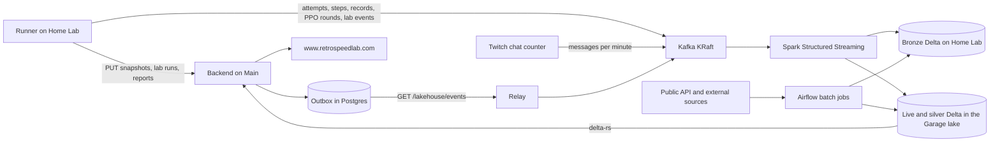

# Retro Speedlab Lakehouse

The data platform of [Retro Speedlab](https://www.retrospeedlab.com). It ingests the backend's data, the TAS search's
events and the project's external sources into Delta Lake, and the backend serves the site's numbers from it. The
live run streams through Kafka and Spark Structured Streaming; Airflow runs the batch medallion jobs hourly and in
full at night. Spark runs in local mode on the Home Lab server next to the search, capped and niced so it never
starves it.

## Architecture



| Server | App | Role |
|--------|-----|------|
| Home Lab | `retro-speedlab-kafka` | Kafka in KRaft mode, one broker, topics kept 7 days |
| Home Lab | `retro-speedlab-lakehouse` `relay` | Moves the backend's outbox events to Kafka every second |
| Home Lab | `retro-speedlab-lakehouse` `stream` | Spark Structured Streaming: the live run every 30 s, everything else every 5 minutes |
| Home Lab | `retro-speedlab-lakehouse` `chat` | Counts Twitch chat messages and chatters, and reads viewers and followers from Helix, per minute, without keeping names or messages |
| Home Lab | `retro-speedlab-lakehouse` `airflow` | Airflow 3 (LocalExecutor, one task at a time) running the Spark batch jobs |
| Main | `retro-speedlab-lake` | Garage, an S3-compatible store with the live, silver and gold tables the site serves |

Bronze keeps the complete raw history for 12 months and stays on the Home Lab server; only what the site serves goes
to the lake on Main. Spark writes the lake over HTTPS with s3a; the backend reads it with a read-only key and
delta-rs. No console and no Airflow or Spark UI is public, and the lake's proxy drops Garage's wildcard CORS
headers. The lakehouse runs as an unprivileged user that owns its data.

## Tables

| Table | Written by | Keys | Content |
|-------|------------|------|---------|
| `bronze.events` | stream | `event_id` | Every outbox event from Kafka |
| `bronze.search_events` | stream | `topic`, `partition`, `offset` | Every event the runner and the chat counter published |
| `bronze.videos` | `videos-nightly` | `game`, `name`, `version` | Every version of the backend's per-game videos |
| `bronze.api` | `api-hourly`, `api-nightly` | | Snapshots of the public API |
| `bronze.sources` | `sources-hourly`, `sources-nightly` | | Every load of the external sources, with watermarks in `bronze.source_watermarks` |
| `bronze.trace_pieces` | `mine-records` | `game`, `record`, `segment` | Every piece of every verified record, with its inputs and whether its replay matches the record's RAM |
| `bronze.frame_traces` | `mine-records` | `game`, `frame` | The newest record per game replayed frame by frame |
| `live.live_run` | stream | `slot` | The run on stream, served by `GET /live/speedrun` |
| `live.stream_status` | stream | `stream` | Events per minute and the lag from the outbox to the Delta commit |
| `live.search_pulse` | stream | `game` | The last hour of the search: attempts, crossings, frames saved, improvements, records |
| `live.policy_pulse` | stream | `game` | The newest PPO round and the last hour's rounds and mean reward |
| `live.lab_status` | stream | `slot` | The newest lab-run event of the last hour |
| `live.chat_pulse` | stream | `channel` | The newest minute of chat and the last hour's messages |
| `live.host_metrics`, `silver.host_metrics` | stream | `host`, `measured_at` | Each server's newest disk, memory, load and CPU, and every minute of them |
| `silver.gpu_metrics` | stream | `host`, `gpu`, `measured_at` | Every minute of each GPU: utilisation, memory, temperature and power |
| `silver.game_runs`, `silver.run_versions` | stream | `game`, `event_id` | The newest run per game and every reported run |
| `silver.reports`, `silver.lab_runs`, `silver.highscores` | stream | | Lab reports, lab runs and highscore entries |
| `silver.donations` | stream | `message_id` | Every Ko-fi payment: kind, amount and currency, with the name and message of public supporters only |
| `silver.deleted_lab_runs` | `api-hourly`, `api-nightly` | `game`, `stamp` | Lab runs the backend answers 404 for although the lake has them; they leave `silver.lab_runs` and every lab cost and round from Tempo, so a lab run deleted at the backend never comes back |
| `silver.games`, `silver.lab_run_progress` | `silver` | | The RetroSpeedLab24 collection and the progress after each lab run |
| `silver.splits`, `silver.history`, `silver.knowledge` | `silver` | | Level splits, improvement history and game knowledge |
| `silver.source_numbers` | `sources-hourly`, `sources-nightly` | `source`, `metric` | The numbers of each source's newest load |
| `silver.trace_daily` | `sources-hourly`, `sources-nightly` | `date` | The lab runs' traced steps, tokens and model cost per UTC day, from Tempo |
| `silver.game_plays` | `sources-hourly`, `sources-nightly` | `mode`, `window` | Umami's newest count of human game starts and campaign wins per game |
| `silver.itch_plays` | `sources-hourly`, `sources-nightly` | `mode`, `window` | Umami's newest count of game starts and campaign wins per game in the RetroSpeedLab24 pack on itch.io |
| `silver.itch_daily` | `sources-hourly`, `sources-nightly` | `date` | The itch.io pack's page views and visitors per UTC day, with views, starts, levels cleared and wins per game |
| `silver.youtube_daily` | `sources-hourly`, `sources-nightly` | `date` | The YouTube channel's views, minutes watched, average view, subscribers gained and lost, likes, comments and shares per day of the last 28, re-read each load because YouTube reports two to three days late |
| `silver.game_dropoff` | `sources-hourly`, `sources-nightly` | `game` | Umami's campaign runs that ended without a win, per level, and the wins since tracking began |
| `silver.bluesky_posts` | `sources-hourly`, `sources-nightly` | `uri`, `measured_at` | Every load's likes, reposts, replies and quotes of each of the Bluesky account's own posts and the account's followers, so the counts keep their history |
| `silver.lab_costs` | `sources-hourly`, `sources-nightly` | `stamp` | The traced steps, tokens and model cost of every lab run, from its `lab scores` span in Tempo |
| `silver.lab_rounds` | `sources-hourly`, `sources-nightly` | `stamp`, `round` | Every `claude -p` round of a lab run from its trace in Tempo: duration, model, cost, turns, tool calls and errors, subagents, input, output and cache tokens; read since the last run |
| `gold.lab_run_rounds` | `sources-hourly`, `sources-nightly` | `stamp`, `round` | The rounds, for the website |
| `gold.lab_run_traces` | `sources-hourly`, `sources-nightly` | `game`, `stamp` | Every traced lab run: rounds, minutes, first model, cost, tokens and tool calls, with its commits from `silver.lab_runs` and the frames its change saved from `gold.lab_roi` |
| `gold.lab_trace_daily` | `sources-hourly`, `sources-nightly` | `date`, `game` | The traced lab runs, rounds, cost, tokens and tool calls per UTC day and game |
| `silver.verifier_replays`, `silver.verifier_splits` | `verify-replays` | `side`, `entry` | Human highscore runs and the AI's newest records replayed through the served game's verifier |
| `gold.game_summary` | `gold` | `game` | Record, levels cleared, seconds saved, costliest level, lab runs, change since yesterday |
| `gold.level_costs` | `gold` | `game`, `level` | Frames and share of the run per level |
| `gold.improvement_curve` | `gold` | `game`, `hour` | The proven run's length per hour |
| `gold.records_daily` | `gold` | `game`, `date` | The record at the end of each day |
| `gold.lab_outcomes` | `gold` | `game`, `outcome` | Lab runs, minutes, cost and commits per outcome |
| `gold.supporter_counts` | `gold` | `kind`, `currency` | Ko-fi payments, public payments, amount and the first and last payment |
| `gold.lab_experiments` | `experiments` | `game`, `stamp`, `metric` | Every deployed lab change as a before/after experiment |
| `gold.lab_roi` | `experiments` | `game`, `stamp` | Every lab run's traced cost, the frames its change saved with an interval, frames per dollar, running totals and the early harm flag |
| `gold.promotion_roi` | `gold` | `channel`, `variant` | Claude cost, views, likes and follows of the published drafts, with views and likes per dollar and their intervals |
| `silver.promotion_decisions` | `gold` | `draft` | Every approved or rejected promotion draft: network, kind, game, variant, text, when, and its length, numbers, opening and tone |
| `gold.promotion_preferences` | `gold` | `channel`, `feature`, `value` | The maintainer's approval rate per network and kind, variant and text feature, with counts and a 90% interval, and the Bluesky interactions per post at 24 h |
| `gold.search_allocation` | `search-allocation` | `game`, `role` | The search bandit's recommended share of workers per kind |
| `gold.search_bandit` | `search-bandit` | `metric` | Bandit turns against held-out static turns |
| `silver.engagement_events` | `engagement-hourly` | `surface`, `item`, `arm`, `hour` | Exposures and outcomes per item: views and clicks from Umami, stream minutes with the chat they overlapped, promotion posts with their interactions |
| `silver.community_daily` | `engagement-nightly` | `date` | Discord messages in public channels and joins per day, counts only |
| `gold.content_ranking` | `engagement-hourly` | `surface`, `item` | Each surface's posterior mean, 90% interval, share and sampled order for the next hour |
| `gold.engagement_experiments` | `engagement-nightly` | `experiment`, `metric` | Adaptive against holdout and the site and stream A/B tests, with SRM check, Holm and BH |
| `gold.experiment_plan` | `engagement-nightly` | `experiment` | Which site and stream A/B tests run, are queued or decided, the metric each is judged on and since when, every candidate metric's data per arm and weeks of data, exposures per week and weeks to a decision |
| `gold.twitch_channel_outcomes` | `engagement-hourly` | `item`, `started_at` | Every turn of a Twitch category and title: average and peak viewers, viewer-hours, new followers per hour and chat messages per viewer-hour |
| `gold.source_numbers` | `sources-hourly`, `sources-nightly` | `source`, `metric` | The sources' numbers of the last 2 days |
| `gold.game_plays` | `sources-hourly`, `sources-nightly` | `game`, `mode`, `window` | Human starts and campaign wins of every game, served on the highscore boards |
| `gold.itch_plays` | `sources-hourly`, `sources-nightly` | `game`, `mode`, `window` | Starts and campaign wins of every game in the itch.io pack, served on the highscore boards |
| `gold.itch_daily` | `sources-hourly`, `sources-nightly` | `game`, `date` | Views, starts, levels cleared and campaign wins of every game in the itch.io pack per UTC day |
| `gold.bluesky_posts` | `sources-hourly`, `sources-nightly` | `uri` | Each of the account's Bluesky posts: text, when, its newest likes, reposts, replies and quotes, and its interactions and the followers at 24 h |
| `gold.human_dropoff` | `sources-hourly`, `sources-nightly` | `game`, `level_index` | Per level the campaign runs that reached it, the share that ended there, and the humans' median time against the AI's split |
| `gold.level_segments`, `gold.mining_summary`, `gold.level_history` | `mining-gold` | `game` | Frames per level and piece of the newest record, and every change of a level's frames |
| `gold.position_heatmap`, `gold.ram_heatmap` | `mining-gold` | `game`, `level` | Frames per 16 px cell and per shown RAM value |
| `gold.board_history`, `gold.humans_vs_ai`, `gold.split_comparison`, `gold.verification_stats` | `mining-gold` | `game` | Best human against the AI, per-level comparisons and replay verdicts |
| `gold.platform_tables`, `gold.platform_jobs` | `platform`, every job | | Size and versions per table, measured nightly, and every job run |
| `silver.lineage_events` | every job, `platform` | `run` | One OpenLineage event per job run (the tables and outside systems it read and wrote, or `FAIL`), and a `RUNNING` event per long-running process: relay, runner, chat and the three stream queries |
| `gold.lineage_nodes`, `gold.lineage_edges` | `platform` | `node`; `source`, `target`, `job` | The current graph: sources, Kafka topics, tables and exports as nodes, and the newest successful run of each job as edges from its inputs to its outputs; the data page draws it |
| `silver.search_turn_minutes`, `silver.search_kind_minutes` | `tracking-hourly` | `run`, `step`; `run`, `kind`, `step` | Each minute of a search turn: frames saved, best time, records, crossings, attempts per second and stuck states, and per worker kind its frames saved per worker-second and share |
| `silver.ppo_rounds` | `tracking-hourly` | `run`, `round` | Every PPO round: reward, exits, episodes, exit rate, entropy, explained variance, loss and the run's hyperparameters |
| `gold.search_turns` | `tracking-hourly` | `game`, `turn` | Each search turn: arm, minutes, frames saved in total and per hour, attempts per second, best time, records, crossings and stuck states |
| `gold.search_worker_kinds` | `tracking-hourly` | `game`, `turn`, `kind` | Each turn's workers per kind, their frames saved per worker-second (weighted by share) and their share of the worker-seconds |
| `gold.training_rounds` | `tracking-hourly` | `game`, `round` | The rounds of each game's newest PPO run, with the reward's mean over the last 10 rounds |
| `gold.sources_status` | `sources-hourly`, `sources-nightly` | `source`, `stream` | Each source's newest load and its records |
| `gold.quality_reports`, `gold.quality_failures` | every write | | The data-quality report of every silver, gold and live write, and the failed ones again |

Writes use Delta MERGE (newest event wins); the live pulse tables are overwritten. Every merge compacts its table
once it has 50 small files (Delta auto compaction), so a job reads a table across the uplink in a few requests instead
of one per write since the last night; appends, like the bronze tables and the quality reports, wait for the night. The nightly `maintenance` job runs
OPTIMIZE, VACUUM and the retention of each layer, starting with the tables that have the fewest files in that
night's `gold.platform_tables`, and leaves the tables it has no time for after 30 minutes to a later night: from then on
it cancels every Spark job it starts, and VACUUM deletes in Spark jobs too, so the budget holds in the
middle of a table. The event schemas are in [EVENTS.md](EVENTS.md).

## Quality gate

Every silver, gold and live write first passes a [pyspark-data-quality](https://pypi.org/project/pyspark-data-quality/)
suite (`quality/suites.py`): keys present and unique, allowed outcomes, non-negative times and frames, at most one
live run. A failing suite stops the write and the job; its report lands in `gold.quality_reports` either way.

## External sources

The sources jobs load only aggregated, public, non-personal numbers, never a message, a name or a raw response:
Uptime Kuma, Twitch, Discord (nightly also messages and joins per day), Umami (including the game site's starts,
campaign wins and the level where a campaign run ends without a win per game, the itch.io pack's views, visitors, starts,
levels cleared and wins per game and day, and hourly the engagement events),
Tempo (the steps, tokens and cost of every lab run's traces), Bugsink, GitHub and Bluesky (the account's own public
posts with their likes, reposts, replies and quotes, from the public AppView) and the YouTube Analytics API (the
channel's last 28 days in total and per day). Each source loads on its own; one
that fails keeps the others and fails the job afterwards.

## Experiment tracking

Core publishes every minute of a search turn as `runs.turn_minutes` and every PPO round as `policy.rounds`; both land
in `bronze.search_events` with the other search topics. `tracking-hourly` reads the last two days of them and merges
them by run and minute or round, so a load that repeats is harmless. A turn ends with its `final` minute, and a turn or
PPO run whose newest event is older than an hour has ended too. The job then rebuilds the gold tables and replaces
them, every PPO round and the last 30 days of turn, worker kind, host and GPU minutes in the experiments Postgres, so
Grafana is at most an hour behind.

## Lab experiments

The nightly `experiments` job treats every deployed lab change as an experiment on its game, using
[experimentation-toolkit](https://pypi.org/project/experimentation-toolkit/). Control is the searched hours before
the change, treatment the searched hours after it (each at most 72).

| Metric | Better | Analysis |
|--------|--------|----------|
| `frames_saved_per_hour` | higher | Welch's t-test on frames saved per searched hour |
| `crossing_rate` | higher | Score test and Newcombe interval on attempts that crossed into a new state |
| `record_hour_rate` | higher | The same on searched hours with a new record |
| `verify_failure_rate` | lower | The same on won runs that did not replay from power-on |

A metric needs at least 12 searched hours on both sides, and rates at least 30 trials. The verdict is `better` or
`worse` only when the Holm-adjusted p-value is at most 0.05 and the 95 % interval excludes zero on that side;
Benjamini-Hochberg adjusted p-values are reported alongside.

Harm is watched sooner: after every searched hour from the second on, a one-sided group-sequential test with
O'Brien-Fleming alpha spending (Lan-DeMets, alpha 0.05, planned for 72 hours) checks whether frames saved per hour
fell. A crossing flags the change in `gold.lab_roi` with the hours it took, so the lab can revert it early.

## ROI

- **Lab:** each lab run's traced cost against its effect, frames saved per hour times the searched hours after
  the change, with the 95 % interval from the experiment. A run that changed nothing saved zero frames; a change
  without enough hours and a run without a traced cost do not count. Totals add half-widths in quadrature.
- **Promotion:** the backend publishes the tokens and Claude cost of every draft's copy to `promotion.usage`; a
  call shared by several networks splits its cost evenly. Views and likes per dollar use the newest metrics of the
  published drafts, with a t interval over the drafts.
- **Search:** frames saved per CPU-hour per game and worker kind come from `gold.search_allocation`. Every worker
  kind runs on a CPU; the GPU only trains the PPO policy, so no frames are attributed to GPU-hours.

## Search bandit

The search has five worker kinds (`scout`, `backtracker`, `beam-scout`, `vision-scout`, `polisher`). The nightly
`search-allocation` job models each game's frames saved per worker-second and kind over the last `bandit.days` as
Gamma-Poisson, with the game's pooled rate as the prior. Thompson sampling (`bandit.draws`) gives each kind's chance
of being the best; its share is `bandit.min_share` plus that chance times the rest, so every kind keeps exploring.

The runner reads the shares from `GET /lakehouse/allocation/{slug}` at the start of a turn and splits its workers by
them. A fifth of the turns keep the static split as the holdout, and every split is published to `runs.allocations`.
The nightly `search-bandit` job compares frames saved per hour of bandit and holdout turns with Welch's t-test; with
fewer than 12 turns on either side it reads `not enough data yet`.

## Engagement learning

The homepage, the games site, the stream, the runner's featured game and the promotion drafts learn what engages
people. `engagement-hourly` joins exposures with outcomes over `engagement.window_days`: Umami's `rank-view`,
`rank-click`, `variant-view` and `variant-goal` events per item and arm, the stream's scene and clip exposures with the
chat minutes they overlap, and promotion posts with their interactions. Click rates are Beta, messages per minute and
interactions per post Gamma, with a prior worth `prior_weight` exposures at the surface's pooled rate. Thompson draws
give each item's chance to lead; its share mixes that with `min_visibility`, so every item keeps a floor, and the next
hour's order draws its leader by share and the rest by one Thompson draw. Catalog games are ranked before they are
first seen. The backend follows a ranking only while that surface's switch is on, with 12% of visits or hours in random
order as the holdout.

The Twitch channel learns its category and title the same way: each hour's pair is an item of `twitch_channel`,
measured in `gold.twitch_channel_outcomes` against the viewers, followers and chat minutes its turns overlapped. Its
reward is new followers per hour, Gamma over the turns' hours, because a follow is the growth that lasts: it brings
the viewer back at every go-live, while viewers and chat per viewer-hour stay beside it in the table. 12% of the hours
show a random pair as the holdout, and `engagement-nightly` compares their followers per hour with the learned hours
as `holdout_twitch_channel`. Each surface in `config.yaml` names the `metric` of its reward.

Bluesky posts publish without review and learn from their engagement. Each post's draft records five dimensions in
`copy.dimensions` (hook, length, media, tags, cta), and every value is an item of `bluesky_<dimension>`, Gamma over the
post's likes, reposts, replies and quotes 24 h after posting from `gold.bluesky_posts`. Its exposure is the post's
followers at that point over the largest such follower count, so a post to a smaller audience counts as less than one
post and the rate reads as interactions per post at today's audience. The backend draws each dimension by its share,
keeps the floor and the holdout trying the others, and retires a value whose interval lies clearly below the best.

YouTube Shorts still learn what the maintainer approves. Every approved or rejected draft is an item
`network:variant` of `promotion_variants`, Beta over decisions with approvals as the outcome.
`gold.promotion_preferences` shows the approval rate per kind, variant, opening, tone, length and count of numbers with
its counts and interval.

`engagement-nightly` compares adaptive with holdout per surface, the site A/B tests per goal rate and the stream A/B
tests per 30-minute block on the metrics listed as their `goals` (chat messages, new followers and average viewers per
block), with experimentation-toolkit, an SRM check, Holm and Benjamini-Hochberg. A variant wins only with a clear Holm
verdict on its primary metric and no sample ratio mismatch; the other metrics are descriptive. Stream metrics are
compared with Welch's t-test on the per-block values: at today's audience chat and follows are small, zero-heavy counts
that burst, so a Poisson test would understate their variance, while Welch uses the observed spread and the blocks,
not the messages, are the randomized units.

A site test's primary metric is its first goal. A stream test's primary metric follows the audience: each night every
candidate is sized from the window's real blocks, and the one that needs the fewest weeks of data becomes primary (ties
go to the first listed). The plan moves to another metric only when it needs less than half the weeks of the current
one (`engagement.plan.switch_speedup`), so near ties never flap, and records the switch in `metric_since`. The `chat` process also publishes Helix's viewers and followers per minute to `twitch.minutes`.

The same job plans which A/B tests run, per surface (site or stream), in `gold.experiment_plan`, which the backend
follows. For each test it takes the exposures per week of the window and the baseline of its primary metric, and sizes
the test for a relative change of `engagement.plan.minimum_effect` at `power`, two-sided at 0.05 divided by the tests
running on that surface (the first Holm step). Tests run, most exposure first, while every running test would decide
within `horizon_weeks` (at most the window, since older data leaves it); the rest are queued and show their control.
When none can, the one closest to a decision runs, and a test with a winner is decided and frees its place.

## Lineage

Every table read and write goes through `lake/tables.py`, so each job records what it touched. `run_job` adds the outside
systems it knows (the backend, each source, the mined records, Grafana's Postgres) and writes an
[OpenLineage](https://openlineage.io) run event to `silver.lineage_events`. The relay, runner, chat and stream queries are
declared in `lineage/topology.py` and recorded each night. `platform` builds the nodes and edges in gold from the newest
successful event of each job, so lineage is per job, not per column. The backend serves them with
`GET /lakehouse/platform` and the website draws them. The openlineage-spark listener and Airflow's OpenLineage provider are
not used: the job runner already knows each job's tables, and no catalog service runs.

## Grafana

The owner's Grafana on the Home Lab shows the lab's traces, the lake's experiment results, the search turns, the PPO
training and the servers. Its data sources and
dashboards are provisioned from `grafana/` and cannot be changed in the UI; `dokku/grafana-setup.sh` copies them and
restarts Grafana.

| Dashboard | Data source | Shows |
|-----------|-------------|-------|
| Experiments | Experiments Postgres | The experiment plan, every engagement experiment's arms, effect, confidence interval, p-value and Holm verdict, each Twitch category and title pair's followers per hour and share, and every lab change |
| Search bandit | Experiments Postgres | The bandit against the holdout split, frames saved per hour per day and arm, and every finished turn |
| Promotion variants | Experiments Postgres | Each channel's variants with reach per dollar, the Bluesky engagement per post of each dimension, the approval rate of each Short feature and the Ko-fi supporters |
| Lab runs | Tempo | Each lab run's scores, each `claude -p` round, the failed steps and the progress after each run |
| Search turns | Experiments Postgres | Per game, release and version: frames saved per hour of each turn by arm, attempts per second, best time, records and stuck states per minute, and each worker kind's efficiency and share |
| Training | Experiments Postgres | Per game, release, version and run: reward, exit rate, entropy, explained variance, loss and episodes per round, and every run's hyperparameters |
| Machines | Experiments Postgres | CPU, load, memory and the fullest disk of each server, and the Home Lab GPU's utilisation, memory, temperature and power |

Grafana cannot read Delta, so the nightly `experiments-export` job copies `gold.engagement_experiments`,
`gold.experiment_plan`, `gold.lab_experiments`, `gold.search_bandit`, `gold.promotion_roi`, `gold.promotion_preferences`, `gold.content_ranking`, `gold.supporter_counts` and every finished
search turn (`search_bandit_turns`) into a small Postgres, each table replaced in one transaction. The job writes as
the database's owner, Grafana reads with a role that may only select (`grafana/reader.sql`).

Core exports each lab run with OpenTelemetry over OTLP/HTTP to Tempo, one trace per round and a `lab scores` span
with the run's scores (`session.id` is `lab-run STAMP`). Tempo keeps the traces for a year on the data disk and has no
published port: the runner, Grafana and the lakehouse reach it on the `retro-speedlab-traces` network. The Postgres is
on the lakehouse's network, also without a published port.

Grafana listens on `127.0.0.1:18094` only, so only the LAN's nginx behind the owner sign-in reaches it. Anonymous
visitors are Viewers, so the owner does not sign in twice; Viewers may use Explore but change nothing, and the admin
login (`GF_SECURITY_ADMIN_PASSWORD`) is for break-glass only. Grafana allows embedding and nginx limits the framing to
the tools page.

## Jobs

| DAG | Schedule (UTC) | Jobs |
|-----|----------------|------|
| `lakehouse_hourly` | minute 10 of every hour outside 02:00 to 06:00 | `api-hourly`, `silver`, then `gold`, `sources-hourly`, `engagement-hourly` and `tracking-hourly` |
| `lakehouse_nightly` | 02:30 | `api-nightly`, `silver`, `gold`, `experiments`, `search-allocation`, `search-bandit`, `engagement-nightly`, `experiments-export`, `platform`, then `sources-nightly`, `videos-nightly` and `maintenance` |
| `lakehouse_mining` | 03:30 | `mine-records`, `verify-replays`, `mining-gold` |

The nightly DAG starts after the first lab run of the day and may run until 06:00. Nightly-only jobs skip when started
outside 02:00 to 06:00 UTC; the hourly DAG pauses in that window, so the nightly and mining jobs have Airflow's single
slot, and `videos-nightly` leaves the videos it has no time for after 40 minutes to the next night. The slot goes to
the nightly chain first, then to mining, then to the nightly jobs aside, so `maintenance` and the videos can no longer
use up the night before `experiments`, `search-allocation`, `search-bandit` and `engagement-nightly` run.

`mine-records` reads the runner's working directories read-only and replays each new record's pieces with
retro-speedlab-core, retro-speedlab-engine and retro-speedlab-games bundled in the image. `verify-replays` runs each
game's served verifier exactly as the backend does. Both take only the games `silver.games` lists, so a game that
left the collection is no longer replayed, and both refuse to start below `mining.min_available_mb` of available
memory.

## Owner tools on the LAN

The tools page and Grafana run on the Home Lab and are reachable from the home LAN only, under their own names with
TLS and behind the owner sign-in.

| Name | Tool | Behind the sign-in | Break-glass login |
|------|------|--------------------|-------------------|
| `tools` | The tools page: every owner dashboard in a sidebar, the selected one in a frame (`lan/tools/index.html`), served by nginx itself | has no login of its own | |
| `grafana` | Grafana, the lab's traces, experiments, search turns, training and servers, on `127.0.0.1:18094` | anonymous Viewer | `admin`, password in `GF_SECURITY_ADMIN_PASSWORD` |

- Every tool publishes its port on localhost only. nginx on the Home Lab serves the names on the LAN address only
  (`lan/tools.conf`), and the firewall opens HTTP and HTTPS on the LAN interface only. The LAN's Pi-hole points the
  names at the Home Lab; outside the LAN they reach Main, which answers only Let's Encrypt challenges for them.
- One Let's Encrypt certificate covers the names. A placeholder app on Main holds them, so the certificate renews there
  over HTTP-01. The Home Lab fetches it daily with a key that may only read that certificate (`lan/pull-certs.sh`),
  checks that it is valid and matches its key, and reloads nginx.
- Main answers names it does not serve with nothing (`lan/main-default.conf`), never with another app.
- nginx asks the owner sign-in's `/check` on Main before each request (`lan/gate.conf`, `lan/signed-in.conf`) and keeps
  a yes for 60 seconds per session, so a page's many requests cost one round trip. A stranger goes to the sign-in page
  and back.
- The tools page keeps the selected tool in the URL hash and frames only the own tools. A deep link such as
  `#bugsink=/issues/issue/<id>/event/last/` opens that path of the tool in its frame; only paths on the tool's own
  origin are accepted. nginx replaces their
  `X-Frame-Options` with `frame-ancestors https://tools.retrospeedlab.com` (`lan/framed.conf`; on Main
  `gate/framed.conf`, which keeps a tool's other CSP directives), so no other page can frame them. GitHub, Twitch,
  YouTube Studio, Google Cloud, Discord, itch.io, Bluesky and the public site refuse framing and Vaultwarden is not
  framed on purpose (clickjacking); they open in a new tab.
- Every password and key is generated on the server once and kept only in the apps' dokku config, readable with
  `config:get`.

## Owner sign-in

Every owner tool signs in through one Discord sign-in at [sso.retrospeedlab.com](https://sso.retrospeedlab.com),
served by the backend. nginx on Main asks the backend's `/check` before each request to a tool (`auth_request`); a
stranger goes to the sign-in page, through Discord and back to the tool. Only the owner's Discord account gets a
session: a signed, HttpOnly cookie for the whole domain, valid 30 days and renewed on use. A tool on another domain
takes the session over with a one-minute ticket at `/_gate/adopt`; there the cookie is `SameSite=None`, like
Bugsink's own cookies, so the tool also works inside the tools page's frame. In exchange nginx refuses every gated
cross-site request except a GET navigation (`$gate_cross_site` in `gate/owner-gate.conf`).

| Tool | Sign-in behind the gate | Public without the gate |
|------|-------------------------|-------------------------|
| Bugsink | trusts `X-Gate-User` (`gate/bugsink`, set by `DJANGO_SETTINGS_MODULE=gate.settings`) | ingest and the token API under `/api/` |
| Uptime Kuma | its own auth is off | status pages, push and badge URLs and their assets |
| Umami | the gate signs in at `/login` and hands the token to the browser | `script.js` and the API under `/api/` |

- `gate/` holds the nginx snippets, one include per tool in `gate/apps` and the Bugsink module;
  `bash dokku/gate-setup.sh APP...` installs them, writes the tools' credentials into root-only nginx includes on Main
  and switches each tool to the gate after its gate is in place.
- nginx strips `X-Gate-User` from every public path and sets it on the gated ones, so no client can name a user.
- The backend needs `SSO_URL`, `SSO_SECRET`, `SSO_OWNER_ID` and `SSO_HOSTS` (the tools' hosts on Main and the LAN);
  Discord must list `https://sso.retrospeedlab.com/callback` as a redirect of the backend's app.

## Alerts

A small collector on each server (`hosts/`) reports disk, memory, load and CPU every minute to the backend, and on the
Home Lab (`GPU=nvidia`) its GPU from `nvidia-smi`. The backend keeps the newest values for its alerts and publishes
them to `hosts.metrics` for `live.host_metrics`, `silver.host_metrics` and `silver.gpu_metrics`.

The backend posts the alerts to a private Discord channel; its rules and thresholds are in its `alerts.yaml`. Every
Airflow task reports its final state to the backend, so a failed task opens an alert and its next success resolves it.

## Configuration

`config.yaml` holds everything except secrets: backend URL, Kafka topics, relay, lake paths and endpoint, Spark,
stream triggers and sources. Secrets come from the environment:

| Variable | Purpose |
|----------|---------|
| `UPLOAD_API_KEY` | The backend's events endpoint |
| `LAKE_ACCESS_KEY_ID`, `LAKE_SECRET_ACCESS_KEY` | The lake; Spark reads them from its environment, so no command line shows them |
| `AIRFLOW__API_AUTH__JWT_SECRET` | Airflow's API |
| `EXPERIMENTS_DATABASE_PASSWORD` | The experiments Postgres Grafana reads, set by `dokku/grafana-setup.sh` |

`dokku/sources.sh` copies the sources' credentials from the backend's config without printing them.

## Deploy

The scripts use the SSH aliases `dokku` (Main), `dokku-black-omen` and `black-omen` (Home Lab). The image installs
every wheel, the Spark jars and the Java runtime from a wheelhouse on the Home Lab server, hash-checked against
`uv.lock`, `jars.lock` and `java.lock`.

```bash
bash dokku/lake-setup.sh      # once, Main: the Garage app, storage, domain and network
bash dokku/lake-deploy.sh     # Main: Garage
ssh dokku letsencrypt:enable retro-speedlab-lake
bash dokku/kafka-setup.sh     # once, Home Lab: Kafka
bash dokku/setup.sh           # once, Home Lab: the lakehouse app, storage, limits and upload key
bash dokku/lake-keys.sh       # once: bucket and keys for the lakehouse and the backend
bash dokku/grafana-setup.sh   # Tempo, the experiments Postgres and Grafana with its dashboards; rerun after a change
bash dokku/lan-setup.sh       # the LAN proxy, sign-in, certificate, Main's default site and Pi-hole names; safe to rerun
bash dokku/gate-setup.sh APP... # the owner sign-in in front of each owner tool on Main; no APP only syncs its hosts
bash dokku/sources.sh         # whenever a source's credentials change
bash dokku/wheelhouse.sh      # whenever uv.lock, jars.lock or java.lock change
bash dokku/deploy.sh retro-speedlab-lakehouse
ssh dokku-black-omen run retro-speedlab-lakehouse python -m retro_speedlab_lakehouse topics config.yaml
bash dokku/hosts-setup.sh     # once: the collector app on both servers, after the topics exist
bash dokku/hosts-deploy.sh    # the collectors
```

## Checks

Tests run PySpark in local mode and need Java 17 or newer.

```bash
uv sync
uv run ruff check .
uv run ruff format --check .
uv run pyright
uv run pytest -q
```
