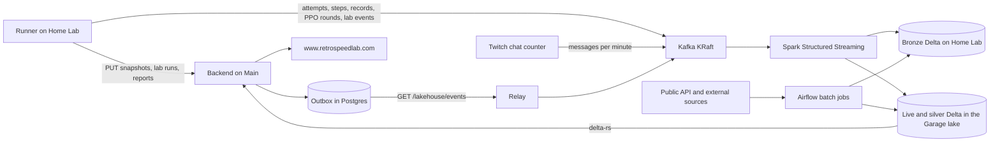
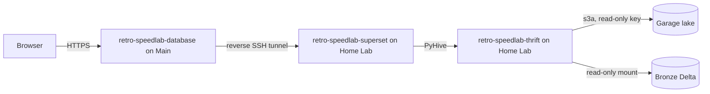

# Retro Speedlab Lakehouse

The data platform of [Retro Speedlab](https://www.retrospeedlab.com). It ingests the backend's data, the TAS search's
events and the project's external sources into Delta Lake, and the backend serves the site's numbers from it. The
live run streams through Kafka and Spark Structured Streaming; Airflow runs the batch medallion jobs hourly and in
full at night. Spark runs in local mode on the Home Lab server next to the search, capped and niced so it never
starves it.

## Architecture



| Server | App | Role |
|--------|-----|------|
| Home Lab | `retro-speedlab-kafka` | Kafka in KRaft mode, one broker, topics kept 7 days |
| Home Lab | `retro-speedlab-lakehouse` `relay` | Moves the backend's outbox events to Kafka every second |
| Home Lab | `retro-speedlab-lakehouse` `stream` | Spark Structured Streaming: the live run every 2 s, everything else every minute |
| Home Lab | `retro-speedlab-lakehouse` `chat` | Counts Twitch chat messages and chatters, and reads viewers and followers from Helix, per minute, without keeping names or messages |
| Home Lab | `retro-speedlab-lakehouse` `airflow` | Airflow 3 (LocalExecutor, one task at a time) running the Spark batch jobs |
| Main | `retro-speedlab-lake` | Garage, an S3-compatible store with the live, silver and gold tables the site serves |

Bronze keeps the complete raw history for 12 months and stays on the Home Lab server; only what the site serves goes
to the lake on Main. Spark writes the lake over HTTPS with s3a; the backend reads it with a read-only key and
delta-rs. No console and no Airflow or Spark UI is public, and the lake's proxy drops Garage's wildcard CORS
headers. The lakehouse and the Thrift Server run as an unprivileged user that owns their data; Superset's metadata
is readable only by Superset.

## Tables

| Table | Written by | Keys | Content |
|-------|------------|------|---------|
| `bronze.events` | stream | `event_id` | Every outbox event from Kafka |
| `bronze.search_events` | stream | `topic`, `partition`, `offset` | Every event the runner and the chat counter published |
| `bronze.videos` | `videos-nightly` | `game`, `name`, `version` | Every version of the backend's per-game videos |
| `bronze.api` | `api-hourly`, `api-nightly` | | Snapshots of the public API |
| `bronze.sources` | `sources-hourly`, `sources-nightly` | | Every load of the external sources, with watermarks in `bronze.source_watermarks` |
| `bronze.trace_pieces` | `mine-records` | `game`, `record`, `segment` | Every piece of every verified record, with its inputs and whether its replay matches the record's RAM |
| `bronze.frame_traces` | `mine-records` | `game`, `frame` | The newest record per game replayed frame by frame |
| `live.live_run` | stream | `slot` | The run on stream, served by `GET /live/speedrun` |
| `live.stream_status` | stream | `stream` | Events per minute and the lag from the outbox to the Delta commit |
| `live.search_pulse` | stream | `game` | The last hour of the search: attempts, crossings, frames saved, improvements, records |
| `live.policy_pulse` | stream | `game` | The newest PPO round and the last hour's rounds and mean reward |
| `live.lab_status` | stream | `slot` | The newest lab-run event of the last hour |
| `live.chat_pulse` | stream | `channel` | The newest minute of chat and the last hour's messages |
| `silver.game_runs`, `silver.run_versions` | stream | `game`, `event_id` | The newest run per game and every reported run |
| `silver.reports`, `silver.lab_runs`, `silver.highscores` | stream | | Lab reports, lab runs and highscore entries |
| `silver.games`, `silver.lab_run_progress` | `silver` | | The LAB24 collection and the progress after each lab run |
| `silver.splits`, `silver.history`, `silver.knowledge` | `silver` | | Level splits, improvement history and game knowledge |
| `silver.source_numbers` | `sources-hourly`, `sources-nightly` | `source`, `metric` | The numbers of each source's newest load |
| `silver.game_plays` | `sources-hourly`, `sources-nightly` | `mode`, `window` | Umami's newest count of human game starts and campaign wins per game |
| `silver.verifier_replays`, `silver.verifier_splits` | `verify-replays` | `side`, `entry` | Human highscore runs and the AI's newest records replayed through the served game's verifier |
| `gold.game_summary` | `gold` | `game` | Record, levels cleared, seconds saved, costliest level, lab runs, change since yesterday |
| `gold.level_costs` | `gold` | `game`, `level` | Frames and share of the run per level |
| `gold.improvement_curve` | `gold` | `game`, `hour` | The proven run's length per hour |
| `gold.records_daily` | `gold` | `game`, `date` | The record at the end of each day |
| `gold.lab_outcomes` | `gold` | `game`, `outcome` | Lab runs, minutes, cost and commits per outcome |
| `gold.lab_experiments` | `experiments` | `game`, `stamp`, `metric` | Every deployed lab change as a before/after experiment |
| `gold.search_allocation` | `search-allocation` | `game`, `role` | The search bandit's recommended share of workers per kind |
| `gold.search_bandit` | `search-bandit` | `metric` | Bandit turns against held-out static turns |
| `silver.engagement_events` | `engagement-hourly` | `surface`, `item`, `arm`, `hour` | Exposures and outcomes per item: views and clicks from Umami, stream minutes with the chat they overlapped, promotion posts with their interactions |
| `silver.community_daily` | `engagement-nightly` | `date` | Discord messages in public channels and joins per day, counts only |
| `gold.content_ranking` | `engagement-hourly` | `surface`, `item` | Each surface's posterior mean, 90% interval, share and sampled order for the next hour |
| `gold.engagement_experiments` | `engagement-nightly` | `experiment`, `metric` | Adaptive against holdout and the site and stream A/B tests, with SRM check, Holm and BH |
| `gold.source_numbers` | `sources-hourly`, `sources-nightly` | `source`, `metric` | The sources' numbers of the last 2 days |
| `gold.game_plays` | `sources-hourly`, `sources-nightly` | `game`, `mode`, `window` | Human starts and campaign wins of every game, served on the highscore boards |
| `gold.level_segments`, `gold.mining_summary`, `gold.level_history` | `mining-gold` | `game` | Frames per level and piece of the newest record, and every change of a level's frames |
| `gold.position_heatmap`, `gold.ram_heatmap` | `mining-gold` | `game`, `level` | Frames per 16 px cell and per shown RAM value |
| `gold.board_history`, `gold.humans_vs_ai`, `gold.split_comparison`, `gold.verification_stats` | `mining-gold` | `game` | Best human against the AI, per-level comparisons and replay verdicts |
| `gold.platform_tables`, `gold.platform_jobs`, `gold.sources_status` | `platform` | | Size and versions per table, and every job run |
| `gold.quality_reports` | every write | | The data-quality report of every silver, gold and live write |

Writes use Delta MERGE (newest event wins); the live pulse tables are overwritten. The nightly `maintenance` job runs
OPTIMIZE, VACUUM and the retention of each layer. The event schemas are in [EVENTS.md](EVENTS.md).

## Quality gate

Every silver, gold and live write first passes a [pyspark-data-quality](https://pypi.org/project/pyspark-data-quality/)
suite (`quality/suites.py`): keys present and unique, allowed outcomes, non-negative times and frames, at most one
live run. A failing suite stops the write and the job; its report lands in `gold.quality_reports` either way.

## External sources

The sources jobs load only aggregated, public, non-personal numbers, never a message, a name or a raw response:
Uptime Kuma, Twitch, Discord (nightly also messages and joins per day), Umami (including the game site's starts and
campaign wins per game, and hourly the engagement events), Langfuse, W&B,
Bugsink and GitHub. Each source loads on its own; one that fails keeps the others and fails the job afterwards.

## Lab experiments

The nightly `experiments` job treats every deployed lab change as an experiment on its game, using
[experimentation-toolkit](https://pypi.org/project/experimentation-toolkit/). Control is the searched hours before
the change, treatment the searched hours after it (each at most 72).

| Metric | Better | Analysis |
|--------|--------|----------|
| `frames_saved_per_hour` | higher | Welch's t-test on frames saved per searched hour |
| `crossing_rate` | higher | Score test and Newcombe interval on attempts that crossed into a new state |
| `record_hour_rate` | higher | The same on searched hours with a new record |
| `verify_failure_rate` | lower | The same on won runs that did not replay from power-on |

A metric needs at least 12 searched hours on both sides, and rates at least 30 trials. The verdict is `better` or
`worse` only when the Holm-adjusted p-value is at most 0.05 and the 95 % interval excludes zero on that side;
Benjamini-Hochberg adjusted p-values are reported alongside.

## Search bandit

The search has five worker kinds (`scout`, `backtracker`, `beam-scout`, `vision-scout`, `polisher`). The nightly
`search-allocation` job models each game's frames saved per worker-second and kind over the last `bandit.days` as
Gamma-Poisson, with the game's pooled rate as the prior. Thompson sampling (`bandit.draws`) gives each kind's chance
of being the best; its share is `bandit.min_share` plus that chance times the rest, so every kind keeps exploring.

The runner reads the shares from `GET /lakehouse/allocation/{slug}` at the start of a turn and splits its workers by
them. A fifth of the turns keep the static split as the holdout, and every split is published to `runs.allocations`.
The nightly `search-bandit` job compares frames saved per hour of bandit and holdout turns with Welch's t-test; with
fewer than 12 turns on either side it reads `not enough data yet`.

## Engagement learning

The homepage, the games site, the stream, the runner's featured game and the promotion drafts learn what engages
people. `engagement-hourly` joins exposures with outcomes over `engagement.window_days`: Umami's `rank-view`,
`rank-click`, `variant-view` and `variant-goal` events per item and arm, the stream's scene and clip exposures with the
chat minutes they overlap, and promotion posts with their interactions. Click rates are Beta, messages per minute and
interactions per post Gamma, with a prior worth `prior_weight` exposures at the surface's pooled rate. Thompson draws
give each item's chance to lead; its share mixes that with `min_visibility`, so every item keeps a floor, and the next
hour's order draws its leader by share and the rest by one Thompson draw. Catalog games are ranked before they are
first seen. The backend follows a ranking only while that surface's switch is on, with 12% of visits or hours in random
order as the holdout.

`engagement-nightly` compares adaptive with holdout per surface, the site A/B tests per goal rate and the stream A/B
tests per 30-minute block on viewers, chat messages per minute and follows per hour, with experimentation-toolkit, an
SRM check, Holm and Benjamini-Hochberg. A variant wins only with a clear Holm verdict on its first metric and no sample
ratio mismatch. The `chat` process also publishes Helix's viewers and followers per minute to `twitch.minutes`.

## Jobs

| DAG | Schedule (UTC) | Jobs |
|-----|----------------|------|
| `lakehouse_hourly` | minute 10 of every hour | `api-hourly`, `silver`, `gold`, `vacuum-live`, `sources-hourly`, `engagement-hourly`, then `platform` |
| `lakehouse_nightly` | 02:30 | `api-nightly`, `silver`, `gold`, `experiments`, `search-allocation`, `search-bandit`, `engagement-nightly`, `maintenance`, `sources-nightly`, `videos-nightly`, then `platform` |
| `lakehouse_mining` | 03:30 | `mine-records`, `verify-replays`, `mining-gold`, `platform` |

The nightly DAG starts after the first lab run of the day. Nightly-only jobs skip when started outside 02:00 to 06:00
UTC, and hourly tasks take priority over nightly ones.

`mine-records` reads the runner's working directories read-only and replays each new record's pieces with
retro-speedlab-core, retro-speedlab-engine and retro-speedlab-games bundled in the image. `verify-replays` runs each
game's served verifier exactly as the backend does. Both refuse to start below `mining.min_available_mb` of available
memory.

## Database

[database.retrospeedlab.com](https://database.retrospeedlab.com) serves Apache Superset's SQL Lab and dashboards on
the lake, for the maintainer only.



- `retro-speedlab-thrift` runs the Spark Thrift Server with Delta and registers every catalog table as
  `<layer>.<table>` at start and every hour. Only Superset can reach it.
- `retro-speedlab-superset` listens on localhost only and is reached through a reverse SSH tunnel to Main, held by a
  systemd service. The tunnel's user has no shell, and its key may only open that one remote forward
  (`database/tunnel/sshd.conf`).
- Superset signs in with Discord only (scope `identify`), and only the Discord user `DISCORD_USER_ID` in
  `database/superset/superset_config.py` gets in, created as Admin on first sign-in. Self-registration is off and the
  public role has no permissions. It shares the backend's Discord app, whose redirects include
  `https://database.retrospeedlab.com/oauth-authorized/discord`.
- The lake connection forbids DML, CTAS and file uploads. Every start imports the dashboards from
  `database/superset/assets.py`.
- Every registered table is a Superset dataset: `database/superset/sync_datasets.py` creates missing ones and
  refreshes their columns at start and every hour.

## Configuration

`config.yaml` holds everything except secrets: backend URL, Kafka topics, relay, lake paths and endpoint, Spark,
stream triggers, sources and the Thrift Server. Secrets come from the environment:

| Variable | Purpose |
|----------|---------|
| `UPLOAD_API_KEY` | The backend's events endpoint |
| `LAKE_ACCESS_KEY_ID`, `LAKE_SECRET_ACCESS_KEY` | The lake; the Thrift Server holds its own read-only pair |
| `AIRFLOW__API_AUTH__JWT_SECRET` | Airflow's API |
| `SUPERSET_SECRET_KEY`, `DISCORD_CLIENT_ID`, `DISCORD_CLIENT_SECRET` | Superset and its Discord login |

`dokku/sources.sh` copies the sources' credentials from the backend's and the runner's config, and
`dokku/database-setup.sh` copies the Discord app's, without printing them.

## Deploy

The scripts use the SSH aliases `dokku` (Main), `dokku-black-omen` and `black-omen` (Home Lab). The image installs
every wheel, the Spark jars and the Java runtime from a wheelhouse on the Home Lab server, hash-checked against
`uv.lock`, `jars.lock` and `java.lock`.

```bash
bash dokku/lake-setup.sh      # once, Main: the Garage app, storage, domain and network
bash dokku/lake-deploy.sh     # Main: Garage
ssh dokku letsencrypt:enable retro-speedlab-lake
bash dokku/kafka-setup.sh     # once, Home Lab: Kafka
bash dokku/setup.sh           # once, Home Lab: the lakehouse app, storage, limits and upload key
bash dokku/lake-keys.sh       # once: bucket and keys for the lakehouse and the backend
bash dokku/database-setup.sh  # once: the Thrift Server, Superset and the proxy on Main
bash dokku/database-tunnel.sh # once: the tunnel's user, key, sshd block, firewall rule and service
bash dokku/sources.sh         # whenever a source's credentials change
bash dokku/wheelhouse.sh      # whenever uv.lock, jars.lock or java.lock change
bash dokku/deploy.sh retro-speedlab-lakehouse retro-speedlab-thrift
ssh dokku-black-omen run retro-speedlab-lakehouse python -m retro_speedlab_lakehouse topics config.yaml
bash dokku/database-deploy.sh # the Thrift Server, Superset and the proxy
ssh dokku letsencrypt:enable retro-speedlab-database
```

## Checks

Tests run PySpark in local mode and need Java 17 or newer.

```bash
uv sync
uv run ruff check .
uv run ruff format --check .
uv run pyright
uv run pytest -q
```
