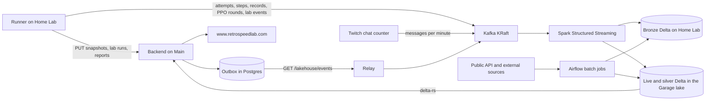
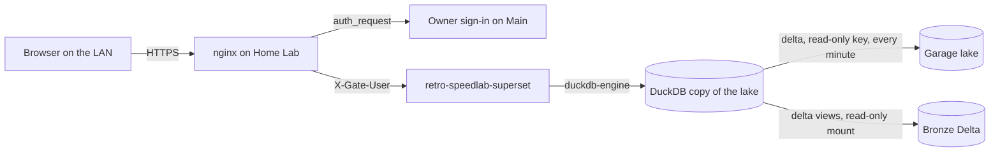

# Retro Speedlab Lakehouse

The data platform of [Retro Speedlab](https://www.retrospeedlab.com). It ingests the backend's data, the TAS search's
events and the project's external sources into Delta Lake, and the backend serves the site's numbers from it. The
live run streams through Kafka and Spark Structured Streaming; Airflow runs the batch medallion jobs hourly and in
full at night. Spark runs in local mode on the Home Lab server next to the search, capped and niced so it never
starves it.

## Architecture



| Server | App | Role |
|--------|-----|------|
| Home Lab | `retro-speedlab-kafka` | Kafka in KRaft mode, one broker, topics kept 7 days |
| Home Lab | `retro-speedlab-lakehouse` `relay` | Moves the backend's outbox events to Kafka every second |
| Home Lab | `retro-speedlab-lakehouse` `stream` | Spark Structured Streaming: the live run every 30 s, everything else every 5 minutes |
| Home Lab | `retro-speedlab-lakehouse` `chat` | Counts Twitch chat messages and chatters, and reads viewers and followers from Helix, per minute, without keeping names or messages |
| Home Lab | `retro-speedlab-lakehouse` `airflow` | Airflow 3 (LocalExecutor, one task at a time) running the Spark batch jobs |
| Main | `retro-speedlab-lake` | Garage, an S3-compatible store with the live, silver and gold tables the site serves |

Bronze keeps the complete raw history for 12 months and stays on the Home Lab server; only what the site serves goes
to the lake on Main. Spark writes the lake over HTTPS with s3a; the backend reads it with a read-only key and
delta-rs. No console and no Airflow or Spark UI is public, and the lake's proxy drops Garage's wildcard CORS
headers. The lakehouse runs as an unprivileged user that owns its data; Superset's metadata and its copy of the lake
are readable only by Superset.

## Tables

| Table | Written by | Keys | Content |
|-------|------------|------|---------|
| `bronze.events` | stream | `event_id` | Every outbox event from Kafka |
| `bronze.search_events` | stream | `topic`, `partition`, `offset` | Every event the runner and the chat counter published |
| `bronze.videos` | `videos-nightly` | `game`, `name`, `version` | Every version of the backend's per-game videos |
| `bronze.api` | `api-hourly`, `api-nightly` | | Snapshots of the public API |
| `bronze.sources` | `sources-hourly`, `sources-nightly` | | Every load of the external sources, with watermarks in `bronze.source_watermarks` |
| `bronze.trace_pieces` | `mine-records` | `game`, `record`, `segment` | Every piece of every verified record, with its inputs and whether its replay matches the record's RAM |
| `bronze.frame_traces` | `mine-records` | `game`, `frame` | The newest record per game replayed frame by frame |
| `live.live_run` | stream | `slot` | The run on stream, served by `GET /live/speedrun` |
| `live.stream_status` | stream | `stream` | Events per minute and the lag from the outbox to the Delta commit |
| `live.search_pulse` | stream | `game` | The last hour of the search: attempts, crossings, frames saved, improvements, records |
| `live.policy_pulse` | stream | `game` | The newest PPO round and the last hour's rounds and mean reward |
| `live.lab_status` | stream | `slot` | The newest lab-run event of the last hour |
| `live.chat_pulse` | stream | `channel` | The newest minute of chat and the last hour's messages |
| `live.host_metrics`, `silver.host_metrics` | stream | `host`, `measured_at` | Each server's newest disk, memory and load, and every minute of them |
| `silver.game_runs`, `silver.run_versions` | stream | `game`, `event_id` | The newest run per game and every reported run |
| `silver.reports`, `silver.lab_runs`, `silver.highscores` | stream | | Lab reports, lab runs and highscore entries |
| `silver.games`, `silver.lab_run_progress` | `silver` | | The LAB24 collection and the progress after each lab run |
| `silver.splits`, `silver.history`, `silver.knowledge` | `silver` | | Level splits, improvement history and game knowledge |
| `silver.source_numbers` | `sources-hourly`, `sources-nightly` | `source`, `metric` | The numbers of each source's newest load |
| `silver.langfuse_daily` | `sources-hourly`, `sources-nightly` | `date` | Langfuse's traced steps, tokens and model cost per UTC day |
| `silver.game_plays` | `sources-hourly`, `sources-nightly` | `mode`, `window` | Umami's newest count of human game starts and campaign wins per game |
| `silver.itch_plays` | `sources-hourly`, `sources-nightly` | `mode`, `window` | Umami's newest count of game starts and campaign wins per game in the LAB24 pack on itch.io |
| `silver.itch_daily` | `sources-hourly`, `sources-nightly` | `date` | The itch.io pack's page views and visitors per UTC day, with views, starts, levels cleared and wins per game |
| `silver.game_dropoff` | `sources-hourly`, `sources-nightly` | `game` | Umami's campaign runs that ended without a win, per level, and the wins since tracking began |
| `silver.lab_costs` | `sources-hourly`, `sources-nightly` | `stamp` | Langfuse's traced steps, tokens and model cost of every lab run's session |
| `silver.verifier_replays`, `silver.verifier_splits` | `verify-replays` | `side`, `entry` | Human highscore runs and the AI's newest records replayed through the served game's verifier |
| `gold.game_summary` | `gold` | `game` | Record, levels cleared, seconds saved, costliest level, lab runs, change since yesterday |
| `gold.level_costs` | `gold` | `game`, `level` | Frames and share of the run per level |
| `gold.improvement_curve` | `gold` | `game`, `hour` | The proven run's length per hour |
| `gold.records_daily` | `gold` | `game`, `date` | The record at the end of each day |
| `gold.lab_outcomes` | `gold` | `game`, `outcome` | Lab runs, minutes, cost and commits per outcome |
| `gold.lab_experiments` | `experiments` | `game`, `stamp`, `metric` | Every deployed lab change as a before/after experiment |
| `gold.lab_roi` | `experiments` | `game`, `stamp` | Every lab run's Langfuse cost, the frames its change saved with an interval, frames per dollar, running totals and the early harm flag |
| `gold.promotion_roi` | `gold` | `channel`, `variant` | Claude cost, views, likes and follows of the published drafts, with views and likes per dollar and their intervals |
| `gold.search_allocation` | `search-allocation` | `game`, `role` | The search bandit's recommended share of workers per kind |
| `gold.search_bandit` | `search-bandit` | `metric` | Bandit turns against held-out static turns |
| `silver.engagement_events` | `engagement-hourly` | `surface`, `item`, `arm`, `hour` | Exposures and outcomes per item: views and clicks from Umami, stream minutes with the chat they overlapped, promotion posts with their interactions |
| `silver.community_daily` | `engagement-nightly` | `date` | Discord messages in public channels and joins per day, counts only |
| `gold.content_ranking` | `engagement-hourly` | `surface`, `item` | Each surface's posterior mean, 90% interval, share and sampled order for the next hour |
| `gold.engagement_experiments` | `engagement-nightly` | `experiment`, `metric` | Adaptive against holdout and the site and stream A/B tests, with SRM check, Holm and BH |
| `gold.twitch_channel_outcomes` | `engagement-hourly` | `item`, `started_at` | Every turn of a Twitch category and title: average and peak viewers, viewer-hours, new followers per hour and chat messages per viewer-hour |
| `gold.source_numbers` | `sources-hourly`, `sources-nightly` | `source`, `metric` | The sources' numbers of the last 2 days |
| `gold.game_plays` | `sources-hourly`, `sources-nightly` | `game`, `mode`, `window` | Human starts and campaign wins of every game, served on the highscore boards |
| `gold.itch_plays` | `sources-hourly`, `sources-nightly` | `game`, `mode`, `window` | Starts and campaign wins of every game in the itch.io pack, served on the highscore boards |
| `gold.itch_daily` | `sources-hourly`, `sources-nightly` | `game`, `date` | Views, starts, levels cleared and campaign wins of every game in the itch.io pack per UTC day |
| `gold.human_dropoff` | `sources-hourly`, `sources-nightly` | `game`, `level_index` | Per level the campaign runs that reached it, the share that ended there, and the humans' median time against the AI's split |
| `gold.level_segments`, `gold.mining_summary`, `gold.level_history` | `mining-gold` | `game` | Frames per level and piece of the newest record, and every change of a level's frames |
| `gold.position_heatmap`, `gold.ram_heatmap` | `mining-gold` | `game`, `level` | Frames per 16 px cell and per shown RAM value |
| `gold.board_history`, `gold.humans_vs_ai`, `gold.split_comparison`, `gold.verification_stats` | `mining-gold` | `game` | Best human against the AI, per-level comparisons and replay verdicts |
| `gold.platform_tables`, `gold.platform_jobs` | `platform`, every job | | Size and versions per table, measured nightly and after mining, and every job run |
| `gold.sources_status` | `sources-hourly`, `sources-nightly` | `source`, `stream` | Each source's newest load and its records |
| `gold.quality_reports`, `gold.quality_failures` | every write | | The data-quality report of every silver, gold and live write, and the failed ones again |
| `gold.cockpit_days` | `cockpit` | `metric`, `days_ago` | The cockpit's numbers per 24-hour window ending now, for the last 8 windows |
| `gold.search_hours`, `gold.audience_hours` | `cockpit` | `hour` | Search, PPO, Twitch and chat per hour of the last 7 days |

Writes use Delta MERGE (newest event wins); the live pulse tables are overwritten. The nightly `maintenance` job runs
OPTIMIZE, VACUUM and the retention of each layer. The event schemas are in [EVENTS.md](EVENTS.md).

## Quality gate

Every silver, gold and live write first passes a [pyspark-data-quality](https://pypi.org/project/pyspark-data-quality/)
suite (`quality/suites.py`): keys present and unique, allowed outcomes, non-negative times and frames, at most one
live run. A failing suite stops the write and the job; its report lands in `gold.quality_reports` either way.

## External sources

The sources jobs load only aggregated, public, non-personal numbers, never a message, a name or a raw response:
Uptime Kuma, Twitch, Discord (nightly also messages and joins per day), Umami (including the game site's starts,
campaign wins and the level where a campaign run ends without a win per game, the itch.io pack's views, visitors, starts,
levels cleared and wins per game and day, and hourly the engagement events),
Langfuse (including the cost of every lab run's session), W&B, Bugsink and GitHub. Each source loads on its own; one
that fails keeps the others and fails the job afterwards.

## Lab experiments

The nightly `experiments` job treats every deployed lab change as an experiment on its game, using
[experimentation-toolkit](https://pypi.org/project/experimentation-toolkit/). Control is the searched hours before
the change, treatment the searched hours after it (each at most 72).

| Metric | Better | Analysis |
|--------|--------|----------|
| `frames_saved_per_hour` | higher | Welch's t-test on frames saved per searched hour |
| `crossing_rate` | higher | Score test and Newcombe interval on attempts that crossed into a new state |
| `record_hour_rate` | higher | The same on searched hours with a new record |
| `verify_failure_rate` | lower | The same on won runs that did not replay from power-on |

A metric needs at least 12 searched hours on both sides, and rates at least 30 trials. The verdict is `better` or
`worse` only when the Holm-adjusted p-value is at most 0.05 and the 95 % interval excludes zero on that side;
Benjamini-Hochberg adjusted p-values are reported alongside.

Harm is watched sooner: after every searched hour from the second on, a one-sided group-sequential test with
O'Brien-Fleming alpha spending (Lan-DeMets, alpha 0.05, planned for 72 hours) checks whether frames saved per hour
fell. A crossing flags the change in `gold.lab_roi` with the hours it took, so the lab can revert it early.

## ROI

- **Lab:** each lab run's Langfuse cost against its effect, frames saved per hour times the searched hours after
  the change, with the 95 % interval from the experiment. A run that changed nothing saved zero frames; a change
  without enough hours and a run without a traced cost do not count. Totals add half-widths in quadrature.
- **Promotion:** the backend publishes the tokens and Claude cost of every draft's copy to `promotion.usage`; a
  call shared by several networks splits its cost evenly. Views and likes per dollar use the newest metrics of the
  published drafts, with a t interval over the drafts.
- **Search:** frames saved per CPU-hour per game and worker kind come from `gold.search_allocation`. Every worker
  kind runs on a CPU; the GPU only trains the PPO policy, so no frames are attributed to GPU-hours.

## Search bandit

The search has five worker kinds (`scout`, `backtracker`, `beam-scout`, `vision-scout`, `polisher`). The nightly
`search-allocation` job models each game's frames saved per worker-second and kind over the last `bandit.days` as
Gamma-Poisson, with the game's pooled rate as the prior. Thompson sampling (`bandit.draws`) gives each kind's chance
of being the best; its share is `bandit.min_share` plus that chance times the rest, so every kind keeps exploring.

The runner reads the shares from `GET /lakehouse/allocation/{slug}` at the start of a turn and splits its workers by
them. A fifth of the turns keep the static split as the holdout, and every split is published to `runs.allocations`.
The nightly `search-bandit` job compares frames saved per hour of bandit and holdout turns with Welch's t-test; with
fewer than 12 turns on either side it reads `not enough data yet`.

## Engagement learning

The homepage, the games site, the stream, the runner's featured game and the promotion drafts learn what engages
people. `engagement-hourly` joins exposures with outcomes over `engagement.window_days`: Umami's `rank-view`,
`rank-click`, `variant-view` and `variant-goal` events per item and arm, the stream's scene and clip exposures with the
chat minutes they overlap, and promotion posts with their interactions. Click rates are Beta, messages per minute and
interactions per post Gamma, with a prior worth `prior_weight` exposures at the surface's pooled rate. Thompson draws
give each item's chance to lead; its share mixes that with `min_visibility`, so every item keeps a floor, and the next
hour's order draws its leader by share and the rest by one Thompson draw. Catalog games are ranked before they are
first seen. The backend follows a ranking only while that surface's switch is on, with 12% of visits or hours in random
order as the holdout.

The Twitch channel learns its category and title the same way: each turn's pair is an item of `twitch_channel`,
measured in `gold.twitch_channel_outcomes` against the viewers, followers and chat minutes it overlapped. Its reward
is new followers per hour, Gamma over the turn's hours, because a follow is the growth that lasts: it brings the
viewer back at every go-live, while viewers and chat per viewer-hour stay beside it in Superset.

`engagement-nightly` compares adaptive with holdout per surface, the site A/B tests per goal rate and the stream A/B
tests per 30-minute block on viewers, chat messages per minute and follows per hour, with experimentation-toolkit, an
SRM check, Holm and Benjamini-Hochberg. A variant wins only with a clear Holm verdict on its first metric and no sample
ratio mismatch. The `chat` process also publishes Helix's viewers and followers per minute to `twitch.minutes`.

## Jobs

| DAG | Schedule (UTC) | Jobs |
|-----|----------------|------|
| `lakehouse_hourly` | minute 10 of every hour | `api-hourly`, `silver`, `sources-hourly`, `engagement-hourly`, `cockpit`, then `gold` |
| `lakehouse_nightly` | 02:30 | `api-nightly`, `silver`, `gold`, `experiments`, `search-allocation`, `search-bandit`, `engagement-nightly`, `sources-nightly`, `videos-nightly`, `maintenance`, then `platform` |
| `lakehouse_mining` | 03:30 | `mine-records`, `verify-replays`, `mining-gold`, `platform` |

The nightly DAG starts after the first lab run of the day. Nightly-only jobs skip when started outside 02:00 to 06:00
UTC, and hourly tasks take priority over nightly ones.

`mine-records` reads the runner's working directories read-only and replays each new record's pieces with
retro-speedlab-core, retro-speedlab-engine and retro-speedlab-games bundled in the image. `verify-replays` runs each
game's served verifier exactly as the backend does. Both refuse to start below `mining.min_available_mb` of available
memory.

## Database

Apache Superset serves SQL Lab and dashboards on the lake, for the maintainer only and on the home LAN only.



- Superset queries a local DuckDB file instead of the lake, because every read of the lake crosses to Main and
  costs seconds. `database/superset/lake_snapshot.py` rebuilds the file a minute after the last build: every live,
  silver and gold table that `gold.platform_tables` lists is copied as `<layer>.<table>`, from the lake only when its
  Delta log has a new commit, and every bronze table is a view on the read-only bronze mount. The new file replaces
  the old one in one rename, so the dashboards show the lake as of about two minutes ago.
- Superset signs in the user the owner sign-in names in `X-Gate-User`; nginx sets that header after the sign-in and
  overrides any a client sends. Its own database login stays as break-glass: its only admin, `owner`, gets the password
  in `SUPERSET_ADMIN_PASSWORD` at every start (`database/superset/owner.py`). Self-registration is off and the public
  role has no permissions.
- Superset opens the DuckDB file read-only and forbids DML, CTAS and file uploads. Every start imports the cockpit's
  dashboards, defined in `database/superset/dashboards.py`.
- Every table in the DuckDB file is a Superset dataset: `database/superset/sync_datasets.py` creates missing ones and
  refreshes their columns at start and every hour.

## Owner tools on the LAN

Superset and GrowthBook run on the Home Lab and are reachable from the home LAN only, under their own names with TLS
and behind the owner sign-in.

| Name | Tool | Behind the sign-in | Break-glass login |
|------|------|--------------------|-------------------|
| `database` | Superset | trusts `X-Gate-User` | `owner`, password in `SUPERSET_ADMIN_PASSWORD` |
| `growthbook` | GrowthBook | the gate signs in as the admin | the admin, password in `GROWTHBOOK_ADMIN_PASSWORD` |
| `growthbook-api` | GrowthBook's API | the UI's calls; `/api/` stays open for SDK and REST keys | |

- Every tool publishes its port on localhost only. nginx on the Home Lab serves the names on the LAN address only
  (`lan/tools.conf`), and the firewall opens HTTP and HTTPS on the LAN interface only. The LAN's DNS points the names
  at the Home Lab; outside the LAN they reach Main, which answers only Let's Encrypt challenges for them.
- One Let's Encrypt certificate covers the names. A placeholder app on Main holds them, so the certificate renews there
  over HTTP-01. The Home Lab fetches it daily with a key that may only read that certificate (`lan/pull-certs.sh`),
  checks that it is valid and matches its key, and reloads nginx.
- Main answers names it does not serve with nothing (`lan/main-default.conf`), never with another app.
- nginx asks the owner sign-in's `/check` on Main before each request (`lan/gate.conf`, `lan/signed-in.conf`) and keeps
  a yes for 60 seconds per session, so a page's many requests cost one round trip. A stranger goes to the sign-in page
  and back.
- On GrowthBook's first page without its `growthbook_gate` cookie, nginx serves `lan/growthbook-login.html`, which
  posts to `/auth/gate` on the API. nginx turns that into GrowthBook's login with the admin's credentials from a
  root-only include, so GrowthBook's own cookies are set without a second login. The cookie lasts one day.
- Images are pinned by version and digest in `dokku/growthbook-setup.sh`.
- Every password and key is generated on the server once and kept only in the apps' dokku config, readable with
  `config:get`.
- GrowthBook's setup creates its only admin, and nginx refuses `/auth/register` and `/auth/firsttime` on the API, so
  nobody else can sign up. A second account needs that block lifted while an invite is accepted.

## Owner sign-in

Every owner tool signs in through one Discord sign-in at [sso.retrospeedlab.com](https://sso.retrospeedlab.com),
served by the backend. nginx on Main asks the backend's `/check` before each request to a tool (`auth_request`); a
stranger goes to the sign-in page, through Discord and back to the tool. Only the owner's Discord account gets a
session: a signed, HttpOnly cookie for the whole domain, valid 30 days and renewed on use. A tool on another domain
takes the session over with a one-minute ticket at `/_gate/adopt`.

| Tool | Sign-in behind the gate | Public without the gate |
|------|-------------------------|-------------------------|
| Bugsink | trusts `X-Gate-User` (`gate/bugsink`, set by `DJANGO_SETTINGS_MODULE=gate.settings`) | ingest and the token API under `/api/` |
| Uptime Kuma | its own auth is off | status pages, push and badge URLs and their assets |
| Umami | the gate signs in at `/login` and hands the token to the browser | `script.js` and the API under `/api/` |

- `gate/` holds the nginx snippets, one include per tool in `gate/apps` and the Bugsink module;
  `bash dokku/gate-setup.sh APP...` installs them, writes the tools' credentials into root-only nginx includes on Main
  and switches each tool to the gate after its gate is in place.
- nginx strips `X-Gate-User` from every public path and sets it on the gated ones, so no client can name a user.
- The backend needs `SSO_URL`, `SSO_SECRET`, `SSO_OWNER_ID` and `SSO_HOSTS` (the tools' hosts on Main and the LAN);
  Discord must list `https://sso.retrospeedlab.com/callback` as a redirect of the backend's app.

## Cockpit and alerts

Five Superset dashboards hold the owner's numbers, every one from the lake and none of them public:

| Dashboard | What it shows |
|-----------|---------------|
| Cockpit | Health first: the runner, the search, the stream lag, the last Airflow job, failed jobs and quality gates, the monitors, and each server's disk, memory and load. Then the last 24 hours against the 24 hours before: records, frames saved, lab runs, highscores, human game starts, viewers, followers, chat, Discord members and the Claude cost of the last full day. Then the return on cost: the lab's frames saved per Claude dollar, the promotion's views per Claude dollar, the search's frames saved per CPU-hour and the lab changes flagged as harmful |
| Return on cost | The lab's frames saved per Claude dollar per game and per run, with intervals and harm flags; the promotion's views and likes per Claude dollar per network and variant, with intervals; the search's frames saved per CPU-hour per worker kind and per game |
| Search and AI | Records per game, frames saved per hour and per game, the bandit's shares and its holdout, PPO reward and loss, the policy now, lab runs and their experiments |
| Audience | Followers, members, visitors and game starts, Twitch viewers and chat per hour, game starts per game, the itch.io pack per game and day, Discord activity, the engagement ranking and the A/B results |
| Platform and cost | Stream lag, Airflow runs and failures, average job minutes, source loads, failed quality gates, disk, memory and load per server, the largest tables, the Claude cost per day, errors and uptime |

The heavy numbers come from the hourly `cockpit` job, so a dashboard reads small gold tables; health reads the `live`
tables directly. A table that does not exist yet shows as a chart error until its first write.

A small collector on each server (`hosts/`) reports disk, memory and load every minute to the backend, which keeps the
newest values for its alerts and publishes them to `hosts.metrics` for `live.host_metrics` and `silver.host_metrics`.

The backend posts the alerts to a private Discord channel; its rules and thresholds are in its `alerts.yaml`. Every
Airflow task reports its final state to the backend, so a failed task opens an alert and its next success resolves it.

## Configuration

`config.yaml` holds everything except secrets: backend URL, Kafka topics, relay, lake paths and endpoint, Spark,
stream triggers and sources. Secrets come from the environment:

| Variable | Purpose |
|----------|---------|
| `UPLOAD_API_KEY` | The backend's events endpoint |
| `LAKE_ACCESS_KEY_ID`, `LAKE_SECRET_ACCESS_KEY` | The lake; Superset holds its own read-only pair |
| `AIRFLOW__API_AUTH__JWT_SECRET` | Airflow's API |
| `SUPERSET_SECRET_KEY` | Superset's session key |
| `SUPERSET_ADMIN_PASSWORD` | Superset's `owner` login |

`dokku/sources.sh` copies the sources' credentials from the backend's and the runner's config without printing them.

## Deploy

The scripts use the SSH aliases `dokku` (Main), `dokku-black-omen` and `black-omen` (Home Lab). The image installs
every wheel, the Spark jars and the Java runtime from a wheelhouse on the Home Lab server, hash-checked against
`uv.lock`, `jars.lock` and `java.lock`.

```bash
bash dokku/lake-setup.sh      # once, Main: the Garage app, storage, domain and network
bash dokku/lake-deploy.sh     # Main: Garage
ssh dokku letsencrypt:enable retro-speedlab-lake
bash dokku/kafka-setup.sh     # once, Home Lab: Kafka
bash dokku/setup.sh           # once, Home Lab: the lakehouse app, storage, limits and upload key
bash dokku/lake-keys.sh       # once: bucket and keys for the lakehouse and the backend
bash dokku/database-setup.sh  # Superset, its mounts and its read-only lake key; safe to rerun
bash dokku/growthbook-setup.sh # GrowthBook, its MongoDB and the admin; rerun after a pin bump
bash dokku/lan-setup.sh       # the LAN proxy, its sign-in, its certificate and Main's default site; safe to rerun
bash dokku/gate-setup.sh APP... # the owner sign-in in front of each owner tool on Main; no APP only syncs its hosts
bash dokku/sources.sh         # whenever a source's credentials change
bash dokku/wheelhouse.sh      # whenever uv.lock, jars.lock or java.lock change
bash dokku/deploy.sh retro-speedlab-lakehouse
ssh dokku-black-omen run retro-speedlab-lakehouse python -m retro_speedlab_lakehouse topics config.yaml
bash dokku/database-deploy.sh # Superset
bash dokku/hosts-setup.sh     # once: the collector app on both servers, after the topics exist
bash dokku/hosts-deploy.sh    # the collectors
```

## Checks

Tests run PySpark in local mode and need Java 17 or newer.

```bash
uv sync
uv run ruff check .
uv run ruff format --check .
uv run pyright
uv run pytest -q
```
