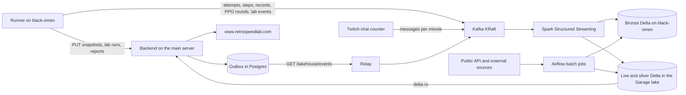
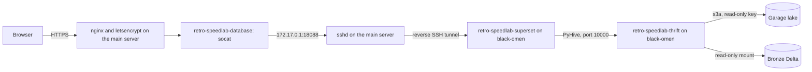

# Retro Speedlab Lakehouse

The data platform of [Retro Speedlab](https://www.retrospeedlab.com). It ingests the backend's data and the
project's external sources into Delta Lake, so that the backend can serve the homepage's values from Delta. The live
run streams through Kafka and Spark Structured Streaming; Airflow runs the batch medallion jobs every hour and in full
at night. Spark runs in local mode (`local[2]`) on black-omen next to the search, capped and niced so it never
starves it.

## Architecture



| Where | What |
|-------|------|
| black-omen `retro-speedlab-kafka` | Kafka 4.3 in KRaft mode, one broker, 768 MB heap, data on `/mnt/fastdata/lakehouse/kafka`, 7 days or 1 GB per topic |
| black-omen `retro-speedlab-lakehouse` `relay` | Moves the backend's outbox events to Kafka every second |
| black-omen `retro-speedlab-lakehouse` `stream` | Spark Structured Streaming: the live run every 2 s, everything else every minute |
| black-omen `retro-speedlab-lakehouse` `chat` | Counts the Twitch chat's messages and chatters per minute, anonymously and without keeping a name or a message |
| black-omen `retro-speedlab-lakehouse` `airflow` | Airflow 3 (LocalExecutor, SQLite, one task at a time) running the Spark batch jobs with `nice -n 15` |
| black-omen `/mnt/fastdata/lakehouse/data/bronze` | Bronze Delta tables: the complete raw history, kept 12 months |
| main server `retro-speedlab-lake` | Garage, an S3-compatible store, with the live, silver and gold Delta tables the site serves |

Bronze stays on black-omen, which has the disk; only what the site serves goes to the lake on the main server.
Spark writes it over HTTPS with s3a and its own key; the backend reads it with a read-only key over the dokku
network with delta-rs. No console and no Airflow or Spark UI is public.

## Tables

| Table | Written by | Keys | What |
|-------|------------|------|------|
| `bronze.events` | stream | `event_id` | Every outbox event as it came from Kafka |
| `bronze.search_events` | stream | `topic`, `partition`, `offset` | Every event the runner and the chat counter published |
| `bronze.videos` | `videos-nightly` | `game`, `name`, `version` | Every version of the backend's per-game videos the mirror copied; the newest file of each is in `/mnt/fastdata/lakehouse/data/bronze/videos/<game>/` |
| `bronze.api` | `api-hourly`, `api-nightly` | | Snapshots of the public API: `/games`, lab runs, nightly also speedrun, knowledge and the lab insight |
| `bronze.sources` | `sources-hourly`, `sources-nightly` | | Every load of the external sources' aggregated numbers, with their watermarks in `bronze.source_watermarks` |
| `silver.source_numbers` | `sources-hourly`, `sources-nightly` | `source`, `metric` | The numbers of each source's newest load |
| `live.live_run` | stream | `slot` | The run on stream, served by `GET /live/speedrun` |
| `live.stream_status` | stream | `stream` | Events per minute and the lag from the backend's outbox to the Delta commit |
| `live.search_pulse` | stream | `game` | The last hour of the search: attempts, attempts per minute over the last 10 minutes, crossings, frames saved, improvements and records |
| `live.policy_pulse` | stream | `game` | The newest PPO round (reward, loss, entropy, exit rate) and the rounds and mean reward of the last hour |
| `live.lab_status` | stream | `slot` | The newest lab-run event of the last hour |
| `live.chat_pulse` | stream | `channel` | The newest minute of chat and the messages of the last hour |
| `silver.game_runs` | stream | `game` | The newest reported run per game |
| `silver.run_versions` | stream | `event_id` | Every reported run: the attempts history |
| `silver.reports`, `silver.lab_runs`, `silver.highscores` | stream | | Lab reports, lab runs and the highscore boards' entries |
| `silver.games`, `silver.lab_run_progress` | `silver` | | The LAB24 collection and the backend's measured progress after each lab run |
| `silver.splits`, `silver.history`, `silver.knowledge` | `silver` | | Each run's level splits, its improvement history and what the AI learned |
| `gold.game_summary` | `gold` | `game` | Record, levels cleared, seconds saved since the first clears, costliest level, lab runs, change since yesterday |
| `gold.level_costs` | `gold` | `game`, `level` | Frames and share of the run per level |
| `gold.improvement_curve` | `gold` | `game`, `hour` | The proven run's length, hour by hour |
| `gold.records_daily` | `gold` | `game`, `date` | The record at the end of each day and the seconds it saved |
| `gold.lab_outcomes` | `gold` | `game`, `outcome` | Lab runs, minutes, cost and commits per outcome |
| `gold.lab_experiments` | `experiments` | `game`, `stamp`, `metric` | Every deployed lab change as an experiment: before against after, with estimates, intervals and Holm and BH adjusted p-values |
| `gold.source_numbers` | `sources-hourly`, `sources-nightly` | `source`, `metric` | The numbers measured in the last 2 days, served on `/tech-stack#data-platform` |
| `gold.platform_tables`, `gold.platform_jobs`, `gold.sources_status` | `platform`, every job | | Rows, bytes, files and versions per table; every job run with its duration and status |
| `gold.quality_reports` | every write | | The pyspark-data-quality report of every silver, gold and live write |
| `bronze.trace_pieces` | `mine-records` | `game`, `record`, `segment` | Every piece of every verified record mined from the runner's working directories, with its inputs and whether its replay ends on the record's RAM byte for byte |
| `bronze.frame_traces` | `mine-records` | `game`, `frame` | The newest record per game replayed frame by frame: level, position and the RAM values the game shows |
| `silver.verifier_replays`, `silver.verifier_splits` | `verify-replays` | `side`, `entry` | Every human highscore run and the AI's newest records replayed through the verifier in the game's served `game.pyxapp`, and the frames each level took |
| `gold.level_segments`, `gold.mining_summary` | `mining-gold` | `game` | Frames per level and piece of the newest record, its costliest level and piece |
| `gold.level_history` | `mining-gold` | `game`, `level`, `at` | Every change of a level's frames in the won runs the search reported |
| `gold.position_heatmap`, `gold.ram_heatmap` | `mining-gold` | `game`, `level` | Frames per 16 px cell and per value of each shown RAM label, per level |
| `gold.board_history`, `gold.humans_vs_ai`, `gold.split_comparison`, `gold.verification_stats` | `mining-gold` | `game` | Every improvement of the best human and the AI, each human run against the AI, per-level frames of verified human runs against the AI's, and the replays' verdicts |

Writes use Delta MERGE (newest event wins), the live pulse tables a plain overwrite of their few rows, `gold.game_summary` compares with itself a day ago by time travel,
and the nightly `maintenance` job runs OPTIMIZE (ZORDER for the run versions and history), VACUUM and the
retention: live tables keep 1 hour of old files and 1 day of log, silver and gold 2 days and 7 days, bronze 7 days
and 30 days with rows kept 12 months.

## External sources

The sources jobs load only aggregated, public, non-personal numbers, never a message, a name or a raw response:

| Source | Numbers |
|--------|---------|
| Uptime Kuma | Uptime of the last 24 hours and the last response time of every monitor on the public status page |
| Twitch | Followers, kept videos and their views, clips and their views, viewers while live |
| Discord | Members and members online |
| Umami | Visitors, visits and page views of the last 7 days, visitors now |
| Langfuse | Traced steps, tokens and model cost of the last 7 days |
| W&B | PPO training runs, the newest run's reward and the versioned policy checkpoints |
| Bugsink | Projects, open and resolved issues and error events |
| GitHub | Repositories, commits of the last 7 days, stars and forks of the public ones (nightly) |

Each source loads on its own: one that fails keeps the others and fails the job afterwards, so
`/tech-stack#data-platform` shows it. `platform` runs either way.

## Lab experiments

The nightly `experiments` job treats every deployed lab run as an experiment on its game, with
[experimentation-toolkit](https://pypi.org/project/experimentation-toolkit/). Control is the searched hours before the
change (since the change before it, at most 72), treatment the searched hours after it (from 30 minutes after the lab
run ended, to allow for the deploy, until the next change, at most 72). A searched hour is one with at least one
search attempt in `bronze.search_events`. The metrics:

| Metric | Better | Analysis |
|--------|--------|----------|
| `frames_saved_per_hour` | higher | Welch's t on the frames the improvements saved per searched hour |
| `crossing_rate` | higher | Score test and Newcombe interval on the attempts that crossed into a new state |
| `record_hour_rate` | higher | The same on the searched hours with a new record from power-on |
| `verify_failure_rate` | lower | The same on the won runs that did not replay from power-on, of all won runs offered |

A metric is analyzed only with at least 12 searched hours on both sides, and for the rates at least 30 trials on
both sides; otherwise it reads `not enough data yet`. The p-values of one change are adjusted with Holm (the verdict)
and Benjamini-Hochberg (reported). The verdict is `better` or `worse` only when the Holm-adjusted p is at most 0.05
and the 95% interval of the effect excludes zero on that side; otherwise `no clear change`.

## Quality gate

Every silver, gold and live write passes a [pyspark-data-quality](https://pypi.org/project/pyspark-data-quality/)
suite first (`quality/suites.py`: keys present and unique, composite keys unique together with `UniqueKey`, allowed
outcomes, non-negative times and frames, at most one live run). A failing suite stops the write and the job; its report
lands in `gold.quality_reports` either way.

## Jobs

| DAG | When (UTC) | Jobs |
|-----|------------|------|
| `lakehouse_hourly` | minute 10 of every hour | `api-hourly`, `silver`, `gold`, `vacuum-live`; beside them `sources-hourly`; then `platform` |
| `lakehouse_nightly` | 02:30, after the 01:35 lab run | `api-nightly`, `silver`, `gold`, `experiments`, `maintenance`; beside them `sources-nightly` and `videos-nightly`; then `platform` |
| `lakehouse_mining` | 03:30, done by 06:00 | `mine-records`, `verify-replays`, `mining-gold`, `platform` |

Lab runs start at 01:35, 07:35, 13:35 and 19:35 and last up to 45 minutes, so the night run starts after the
first one ends. The nightly-only jobs (`api-nightly`, `experiments`, `maintenance`, `sources-nightly`,
`videos-nightly`) run only between 02:00 and 06:00 UTC: started at any other time, by a catch-up or a retry, they
log that and skip. Airflow runs one task at a time; hourly tasks go first (priority 10 against 1), a nightly task
ends after 40 minutes and an hourly one after 25, so the hourly DAG never waits long behind the nightly one. `videos-nightly` copies the backend's per-game videos over its public API, only those whose ETag
changed, and keeps the newest file of each next to `bronze.videos`.

## Mining

`mine-records` reads the runner's working directories read-only (`/runner`), and only records it has not mined yet.
The image carries retro-speedlab-core, retro-speedlab-engine and retro-speedlab-games under `speedlab/`, side by side
as `dokku/deploy.sh` archives them; each Spark task replays its pieces, partitioned by game and piece, in one
`python -m datenwissenschaften.speedrun.trace` process. `verify-replays` downloads each game's served `game.pyxapp`
once per task and runs its bundled verifier exactly as the backend does, then `datenwissenschaften.speedrun.level_clock`
on the same cartridge for the level splits. Both jobs refuse to start with less than `mining.min_available_mb`
available on black-omen and run in the Airflow container, capped at 2 cores and 3.5 GB and niced.

## Database

[database.retrospeedlab.com](https://database.retrospeedlab.com) is Apache Superset's SQL Lab and dashboards on the
lake, for the maintainer only.



| Where | What |
|-------|------|
| black-omen `retro-speedlab-thrift` | The lakehouse image running the Spark Thrift Server in local mode: Delta, an embedded Derby metastore on `/mnt/fastdata/database/thrift`, the lake's read-only `database` key and bronze mounted read-only; 512 MB heap, 1.25 GB and 1 CPU, cpu-shares 256 |
| black-omen `retro-speedlab-superset` | Superset 6.1 with one gunicorn worker, its metadata in SQLite on `/mnt/fastdata/database/superset`, published only on `127.0.0.1:18088`; 768 MB and 1 CPU, cpu-shares 256 |
| black-omen `retro-speedlab-database-tunnel` | A systemd service holding `ssh -R 172.17.0.1:18088:127.0.0.1:18088` to the main server, restarted whenever it drops |
| main server `retro-speedlab-database` | socat from the app's nginx to the tunnel's end on the docker bridge, behind letsencrypt |

The Thrift Server registers every table of the catalog that exists as `<layer>.<table>` (`CREATE TABLE IF NOT EXISTS
... USING DELTA LOCATION ...`) when it starts and every hour, so a deploy or a new table needs nothing else. Nothing
publishes its port: only Superset reaches it, over the `retro-speedlab-database` network.

The tunnel logs in as `database-tunnel` on the main server, a system user without a shell or password. Its key
on black-omen lives in `/etc/retro-speedlab/database-tunnel` and is only allowed to listen on `172.17.0.1:18088`
(`restrict,port-forwarding,permitlisten` in its `authorized_keys`, and `database/tunnel/sshd.conf` as a `Match
User` block: remote forwarding only, no TTY, no agent, no X11). ufw lets only the docker bridge reach that port.

Superset signs in with Discord only, with the scope `identify`, and only the Discord user id `712191617095696493`
gets in, created as Admin on its first sign-in; anyone else is turned away, self-registration is off, `/register/`
answers 404 and the public role has no permissions. It shares the backend's Discord
app: `dokku/database-setup.sh` copies `DISCORD_CLIENT_ID` and `DISCORD_CLIENT_SECRET` from the backend without
printing them, and the app lists `https://database.retrospeedlab.com/oauth-authorized/discord` as a redirect beside
the backend's own.

The lake connection forbids DML, CTAS and file uploads. Every start imports the `Speedrun records` and `Lakehouse
platform` dashboards from `database/superset/assets.py`, overwriting their charts.

## Configuration

`config.yaml` holds everything but the secrets: the backend URL, Kafka's address and topics, the relay's poll and
cursor, the lake's paths and S3 endpoint, Spark's master and memory, the stream's triggers, the sources' GitHub
repositories and status page, and the Thrift Server's port, metastore, registration interval and Spark. The secrets
come from the environment: `UPLOAD_API_KEY` (the backend's events endpoint), `LAKE_ACCESS_KEY_ID` and
`LAKE_SECRET_ACCESS_KEY` (the lake; the Thrift Server holds its own read-only pair), `AIRFLOW__API_AUTH__JWT_SECRET`,
Superset's `SUPERSET_SECRET_KEY`, `DISCORD_CLIENT_ID` and `DISCORD_CLIENT_SECRET`, and the sources' settings, which
`dokku/sources.sh` copies from the backend's and the runner's config without printing them. The event schemas are in
[EVENTS.md](EVENTS.md).

## Deploy

Run it all from WSL. The image installs every wheel, the Spark jars and the Java runtime from black-omen's
`/mnt/fastdata/wheelhouse`, hash-checked against `uv.lock`, `jars.lock` and `java.lock`.

```bash
bash dokku/lake-setup.sh     # once, main server: the Garage app, its storage, domain and network
bash dokku/lake-deploy.sh    # main server: Garage
ssh dokku letsencrypt:enable retro-speedlab-lake
bash dokku/kafka-setup.sh    # once, black-omen: Kafka
bash dokku/setup.sh          # once, black-omen: the lakehouse app, storage, limits and upload key
bash dokku/lake-keys.sh      # once: bucket and keys, the writer key to the lakehouse, the reader key to the backend
bash dokku/database-setup.sh # once: the Thrift Server, Superset, their read-only lake key and the main server's proxy
bash dokku/database-tunnel.sh # once: the tunnel's user, key, sshd block, firewall rule and service
bash dokku/sources.sh        # whenever a source's credentials change
bash dokku/wheelhouse.sh     # whenever uv.lock, jars.lock or java.lock change
bash dokku/deploy.sh retro-speedlab-lakehouse retro-speedlab-thrift
ssh dokku-black-omen run retro-speedlab-lakehouse python -m retro_speedlab_lakehouse topics config.yaml
bash dokku/database-deploy.sh # the Thrift Server, Superset and the proxy
ssh dokku letsencrypt:enable retro-speedlab-database
```

## Development

Tests run PySpark in local mode and need Java 17 or newer.

```bash
uv sync
uv run ruff check . && uv run ruff format --check . && uv run pyright && uv run pytest -q
```
