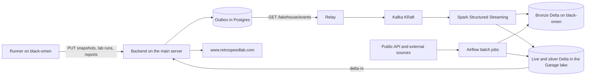
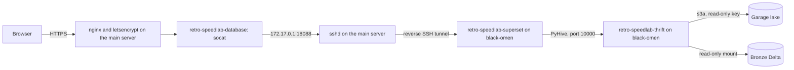

# Retro Speedlab Lakehouse

The data platform of [Retro Speedlab](https://www.retrospeedlab.com). It ingests the backend's data and the
project's external sources into Delta Lake, so that the backend can serve the homepage's values from Delta. The live
run streams through Kafka and Spark Structured Streaming; Airflow runs the batch medallion jobs every hour and in full
at night. Spark runs in local mode (`local[2]`) on black-omen next to the search, capped and niced so it never
starves it.

## Architecture



| Where | What |
|-------|------|
| black-omen `retro-speedlab-kafka` | Kafka 4.3 in KRaft mode, one broker, 768 MB heap, data on `/mnt/fastdata/lakehouse/kafka`, 7 days or 1 GB per topic |
| black-omen `retro-speedlab-lakehouse` `relay` | Moves the backend's outbox events to Kafka every second |
| black-omen `retro-speedlab-lakehouse` `stream` | Spark Structured Streaming: the live run every 2 s, everything else every minute |
| black-omen `retro-speedlab-lakehouse` `airflow` | Airflow 3 (LocalExecutor, SQLite, one task at a time) running the Spark batch jobs with `nice -n 15` |
| black-omen `/mnt/fastdata/lakehouse/data/bronze` | Bronze Delta tables: the complete raw history, kept 12 months |
| main server `retro-speedlab-lake` | Garage, an S3-compatible store, with the live, silver and gold Delta tables the site serves |

Bronze stays on black-omen, which has the disk; only what the site serves goes to the lake on the main server.
Spark writes it over HTTPS with s3a and its own key; the backend reads it with a read-only key over the dokku
network with delta-rs. No console and no Airflow or Spark UI is public.

## Tables

| Table | Written by | Keys | What |
|-------|------------|------|------|
| `bronze.events` | stream | `event_id` | Every outbox event as it came from Kafka |
| `bronze.api` | `api-hourly`, `api-nightly` | | Snapshots of the public API: `/games`, lab runs, nightly also speedrun, knowledge and the lab insight |
| `bronze.sources` | `sources-hourly`, `sources-nightly` | | Raw records of the external sources, with their watermarks in `bronze.source_watermarks` |
| `live.live_run` | stream | `slot` | The run on stream, served by `GET /live/speedrun` |
| `live.stream_status` | stream | `stream` | Events per minute and the lag from the backend's outbox to the Delta commit |
| `silver.game_runs` | stream | `game` | The newest reported run per game |
| `silver.run_versions` | stream | `event_id` | Every reported run: the attempts history |
| `silver.reports`, `silver.lab_runs`, `silver.highscores` | stream | | Lab reports, lab runs and the highscore boards' entries |
| `silver.games`, `silver.lab_run_progress` | `silver` | | The LAB24 collection and the backend's measured progress after each lab run |
| `silver.splits`, `silver.history`, `silver.knowledge` | `silver` | | Each run's level splits, its improvement history and what the AI learned |
| `gold.game_summary` | `gold` | `game` | Record, levels cleared, seconds saved since the first clears, costliest level, lab runs, change since yesterday |
| `gold.level_costs` | `gold` | `game`, `level` | Frames and share of the run per level |
| `gold.improvement_curve` | `gold` | `game`, `hour` | The proven run's length, hour by hour |
| `gold.records_daily` | `gold` | `game`, `date` | The record at the end of each day and the seconds it saved |
| `gold.lab_outcomes` | `gold` | `game`, `outcome` | Lab runs, minutes, cost and commits per outcome |
| `gold.platform_tables`, `gold.platform_jobs`, `gold.sources_status` | `platform`, every job | | Rows, bytes, files and versions per table; every job run with its duration and status |
| `gold.quality_reports` | every write | | The spark-data-quality report of every silver, gold and live write |

Writes use Delta MERGE (newest event wins), `gold.game_summary` compares with itself a day ago by time travel,
and the nightly `maintenance` job runs OPTIMIZE (ZORDER for the run versions and history), VACUUM and the
retention: live tables keep 1 hour of old files and 1 day of log, silver and gold 2 days and 7 days, bronze 7 days
and 30 days with rows kept 12 months.

## Quality gate

Every silver, gold and live write passes a [spark-data-quality](https://github.com/datenwissenschaften/spark-data-quality)
suite first (`quality/suites.py`: keys present and unique, allowed outcomes, non-negative times and frames, at most
one live run). A failing suite stops the write and the job; its report lands in `gold.quality_reports` either way.

## Jobs

| DAG | When (UTC) | Jobs |
|-----|------------|------|
| `lakehouse_hourly` | minute 10 of every hour | `api-hourly`, `sources-hourly`, `silver`, `gold`, `vacuum-live`, `platform` |
| `lakehouse_nightly` | 02:30, after the 01:35 lab run | `api-nightly`, `sources-nightly`, `silver`, `gold`, `maintenance`, `platform` |

Lab runs start at 01:35, 07:35, 13:35 and 19:35 and last up to 45 minutes, so the night run starts after the
first one ends.

## Database

[database.retrospeedlab.com](https://database.retrospeedlab.com) is Apache Superset's SQL Lab and dashboards on the
lake, for the maintainer only.



| Where | What |
|-------|------|
| black-omen `retro-speedlab-thrift` | The lakehouse image running the Spark Thrift Server in local mode: Delta, an embedded Derby metastore on `/mnt/fastdata/database/thrift`, the lake's read-only `database` key and bronze mounted read-only; 512 MB heap, 1.25 GB and 1 CPU, cpu-shares 256 |
| black-omen `retro-speedlab-superset` | Superset 6.1 with one gunicorn worker, its metadata in SQLite on `/mnt/fastdata/database/superset`, published only on `127.0.0.1:18088`; 768 MB and 1 CPU, cpu-shares 256 |
| black-omen `retro-speedlab-database-tunnel` | A systemd service holding `ssh -R 172.17.0.1:18088:127.0.0.1:18088` to the main server, restarted whenever it drops |
| main server `retro-speedlab-database` | socat from the app's nginx to the tunnel's end on the docker bridge, behind letsencrypt |

The Thrift Server registers every table of the catalog that exists as `<layer>.<table>` (`CREATE TABLE IF NOT EXISTS
... USING DELTA LOCATION ...`) when it starts and every hour, so a deploy or a new table needs nothing else. Nothing
publishes its port: only Superset reaches it, over the `retro-speedlab-database` network.

The tunnel logs in as `database-tunnel` on the main server, a system user without a shell or password. Its key
on black-omen lives in `/etc/retro-speedlab/database-tunnel` and is only allowed to listen on `172.17.0.1:18088`
(`restrict,port-forwarding,permitlisten` in its `authorized_keys`, and `database/tunnel/sshd.conf` as a `Match
User` block: remote forwarding only, no TTY, no agent, no X11). ufw lets only the docker bridge reach that port.

Superset signs in with GitHub only, and only the account `datenwissenschaften` gets in, as Admin; anyone else is
turned away and the public role has no permissions. Until the OAuth app's credentials are set the login page has no
provider, so nobody can sign in. Create a GitHub OAuth app with the homepage `https://database.retrospeedlab.com` and
the callback `https://database.retrospeedlab.com/oauth-authorized/github`, then:

```bash
ssh dokku-black-omen config:set retro-speedlab-superset GITHUB_CLIENT_ID=... GITHUB_CLIENT_SECRET=...
```

The lake connection forbids DML, CTAS and file uploads. Every start imports the `Speedrun records` and `Lakehouse
platform` dashboards from `database/superset/assets.py`, overwriting their charts.

## Configuration

`config.yaml` holds everything but the secrets: the backend URL, Kafka's address and topics, the relay's poll and
cursor, the lake's paths and S3 endpoint, Spark's master and memory, the stream's triggers, and the Thrift Server's
port, metastore, registration interval and Spark. The secrets come from the environment: `UPLOAD_API_KEY` (the
backend's events endpoint), `LAKE_ACCESS_KEY_ID` and `LAKE_SECRET_ACCESS_KEY` (the lake; the Thrift Server holds its
own read-only pair), `AIRFLOW__API_AUTH__JWT_SECRET`, and Superset's `SUPERSET_SECRET_KEY`, `GITHUB_CLIENT_ID` and
`GITHUB_CLIENT_SECRET`. The event schemas are in [EVENTS.md](EVENTS.md).

## Deploy

Run it all from WSL. The image installs every wheel, the Spark jars and the Java runtime from black-omen's
`/mnt/fastdata/wheelhouse`, hash-checked against `uv.lock`, `jars.lock` and `java.lock`.

```bash
bash dokku/lake-setup.sh     # once, main server: the Garage app, its storage, domain and network
bash dokku/lake-deploy.sh    # main server: Garage
ssh dokku letsencrypt:enable retro-speedlab-lake
bash dokku/kafka-setup.sh    # once, black-omen: Kafka
bash dokku/setup.sh          # once, black-omen: the lakehouse app, storage, limits and upload key
bash dokku/lake-keys.sh      # once: bucket and keys, the writer key to the lakehouse, the reader key to the backend
bash dokku/database-setup.sh # once: the Thrift Server, Superset, their read-only lake key and the main server's proxy
bash dokku/database-tunnel.sh # once: the tunnel's user, key, sshd block, firewall rule and service
bash dokku/wheelhouse.sh     # whenever uv.lock, jars.lock or java.lock change
bash dokku/deploy.sh retro-speedlab-lakehouse retro-speedlab-thrift
ssh dokku-black-omen run retro-speedlab-lakehouse python -m retro_speedlab_lakehouse topics config.yaml
bash dokku/database-deploy.sh # the Thrift Server, Superset and the proxy
ssh dokku letsencrypt:enable retro-speedlab-database
```

## Development

Tests run PySpark in local mode and need Java 17 or newer.

```bash
uv sync
uv run ruff check . && uv run ruff format --check . && uv run pyright && uv run pytest -q
```
